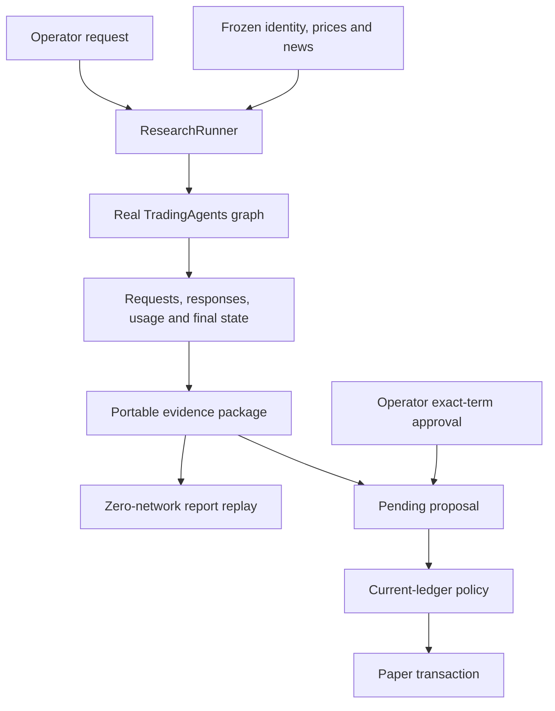

# TradingAgents Research Desk

## Project and participant record

CS5351 Agentic Software Engineering Project. Team: **Alfa, Bravo, Charlie, Delta and Echo**. The implementation extends official TradingAgents **v0.4.0**. Repository: [Fighterforever/cs5351-tradingagents-research-desk](https://github.com/Fighterforever/cs5351-tradingagents-research-desk), public.

| Member | Primary responsibility | Relative contribution |
|---|---|---:|
| Alfa | Requirements and acceptance criteria | 1.0 |
| Bravo | Architecture and context budgets | 1.0 |
| Charlie | Evidence and approval state | 1.0 |
| Delta | Testing and experimental quality | 1.0 |
| Echo | CI, release and report integration | 1.0 |

The team allocates equal responsibility across these five areas, with a mean weight of 1.0. The closing review rotates each area to the next member as set out in docs/process/team.md. Archived development sessions and approvals retain their original operator identifier, leo.

This project uses a genuine language-model research graph to investigate a practical software engineering question: how can a user inspect the evidence behind an AI recommendation, reproduce its presentation, and control the consequences of accepting it? The delivered workflow connects research to a portable evidence package, then to an explicitly approved paper transaction. A second workflow compares the cost and quality of two context strategies using the same underlying research system.

Under evaluation identifier leo, OpenCode generated the application, test, and CI code while the coordinating workflow supplied bounded prompts, reviewed declared contracts, executed experiments, and prepared documentation. The repository preserves the complete OpenCode sessions. The annotated record in transcripts/59072966-Liyu-MA.md links 30 directives across 11 native sessions to exact source messages, with a rationale and observed result for each. The decision identifier leo refers to Liyu MA (59072966). The index also links six user directions from the project conversation and a subsequent Gemini review of requirement classification and architecture candidates.

The report distinguishes the system's research capability from the authority to change paper state. Research can produce useful reasoning while still being uncertain or incomplete. Execution requires an exact approval and a deterministic policy result. The experiment likewise evaluates measured token reduction separately from factual quality.

## 1. Problem, scope and contribution

TradingAgents is a substantial existing multi-agent application. It already separates research perspectives, produces structured decisions and retains research memory. Its reports are valuable to a reader, but an engineering assessment needs additional evidence about how a particular report was produced and what an application may do with it. A saved report alone does not identify every material input or establish that a later action followed the user's approval.

Research Desk delivers five requirement increments through three integrated workflows. Portable evidence and approved paper transactions are the first two increments. Context optimization is the third. The revision adds a complete-input budget and source-bound release acceptance. The table in docs/process/team.md maps these five increments to requirements and evidence. The first captures a run as a transferable evidence package and reconstructs the report in a new process without external calls. The second turns a completed recommendation into an operator-reviewed proposal and applies a paper transaction only after deterministic checks. The third adds context and request-budget controls, then measures a baseline/compact comparison over six fixed cases. Each feature participates in an end-to-end user workflow rather than existing as an isolated demonstration.

The evidence workflow answers the operator's question, “What did this run actually see?” Its package records instrument identity, analysis cutoff, material tool inputs, model requests, model responses and terminal state. Actual provider usage accompanies the calls. The package can be exported as a ZIP and inspected on another machine. The replay path reconstructs saved results, so it has no reason to instantiate a model client. A controlled rerun has a different purpose: it executes the research graph again against the same frozen data, allowing an experiment on context strategy.

The transaction workflow answers, “Which action did I approve?” A proposal includes the research evidence reference, direction, price and operator-selected quantity. Approval refers to exact terms. If those terms change, the old approval cannot authorize the new proposal. The policy checks the current ledger at execution time because the user's earlier review cannot freeze cash or holdings indefinitely. Repeating an already completed execution returns the original transaction instead of applying a second financial side effect.

The context workflow asks whether repeated prompt material can be reduced without damaging evidence-grounded research. The complete selected upstream graph remains in place for both arms. The same DeepSeek model and inference settings are used. The source corpus is fixed before the comparison. Actual token usage supplies the cost measure, while an independent assessment supplies the quality measure. The request budget also provides a concrete degraded-mode behavior: a stopped research run remains inspectable but does not create an approvable recommendation.

The scope deliberately fits a single local operator. The application handles US equities with the market and news analysts, retains the downstream researcher/trader/risk roles, and produces English reports. It offers CLI commands and readable report artifacts. It operates strictly on a local paper ledger without broker integration or live order routing, keeping the execution safety boundary deterministic and testable.

## 2. Existing-system analysis and baseline selection

The baseline is the official v0.4.0 code from TauricResearch/TradingAgents. The initial checkout used the release branch named v0.4.0. Release preparation fetched the complete ancestry and the actual signed upstream v0.4.0 tag, then verified that its source tree was identical to the code tested and extended here. The provenance record is docs/process/upstream-baseline.json. Because the upstream release was new on the execution date, the project pins the signed tag and establishes an explicit local regression baseline.

Source analysis identified the actual extension contracts. TradingAgentsGraph accepts selected analysts, configuration and callbacks. Its propagation path returns a terminal graph state and a signal. The report writer consumes that saved state. Instrument resolution and returns reads include direct data paths that are not ordinary model tool calls. The dependency declarations and provider adapters were also examined before selecting how the extension would access DeepSeek.

Baseline inspection established the extension points provided by TradingAgents. Research Desk reuses its research and persistence contracts, including structured decisions and date-aware memory. Upstream checkpoint and market-data support remain in place, together with callback token accounting. Research Desk connects portable evidence to deterministic proposal review and measures the cost of context control. The requirements registry links inherited capabilities directly to upstream source paths and maps new workflows to extension modules.

The unmodified upstream test run completed with **649 passed, 2 skipped and 71 subtests passed**. The saved log records the invocation and result. The skips concerned an optional AWS dependency and a live DeepSeek integration test that was not given a key in that baseline invocation. The extension retains the full original tests directory. Later regression checks run both the upstream suite and the additional application tests.

The repository layout preserves upstream source and licensing. New application modules live under src/research_desk. New deterministic tests live under test/offline, and API-dependent experiment assets are separated from them. The Python environment belongs to this project. Installing its dependencies does not change the environment used for the separate course assignments. This isolation matters because dependency changes can otherwise create failures in work that the project did not modify.

A real extension also needs to be installable. The first generated slice created its modules but initially omitted the necessary src-layout package-discovery configuration. The CLI then failed to import the package. OpenCode corrected the package discovery configuration in pyproject.toml, restoring the installed research-desk CLI entry point.

## 3. Requirements engineering and acceptance strategy

The machine-readable product requirements document identifies the user and the integrated application workflows. A consolidated registry contains 24 requirements. Each entry has an identifier, type, statement, priority and a fit criterion expressed as a metric, comparison operator, threshold and verification method. Source links identify inherited behavior. Component and test references make the registry useful to implementation and CI rather than merely readable prose.

The priorities follow MoSCoW. Correct evidence handling, deterministic authority and complete measurement are Must requirements. A 20% token reduction and a compact wall time within 110% of baseline are Should targets. This prioritization decouples deterministic safety enforcement from empirical optimization targets during acceptance evaluation.

The strongest invariants have zero-tolerance fit criteria. Every ledger mutation must refer to exact approved terms and passing current-state policy checks. An unapproved, rejected, nontradeable or policy-violating proposal must leave the ledger unchanged. The graph must not gain execution authority from text in a report. No request may begin after the configured call limit, making each invariant directly testable through observable failure states.

The fixed teaching policy starts with USD 100000 cash. Quantities are positive whole shares. Shorting is forbidden. A purchase may not leave one stock above 10% of portfolio equity. The price comes from research evidence; the operator cannot type a favorable execution price. The operator chooses quantity and approves it. A valid sell can reduce an owned position even when the remaining holding is still above the purchase cap; a sell beyond the holding is rejected. Hold and REVIEW do not produce a tradeable proposal.

Eight acceptance specifications cover the important behavior. AT-01 exports and replays a complete package in a new process, then tests an incomplete package. AT-02 checks source availability, cutoff dates and duplicate handling. AT-03 demonstrates a valid approved transaction and repeat execution. AT-04 covers the forbidden execution cases. AT-05 changes approved terms or current portfolio state before execution. AT-06 exercises the actual request limit and critical context preservation. AT-07 compares six paired research runs. AT-08 exercises the six CI gates and their failure paths.

The first plan and test approval preceded the first recorded implementation event. The revision approval likewise preceded its first source edit. Gate 1 checks both sequences against the approval artifacts and raw session events.

The most useful negative cases correspond to plausible business failures. For example, approving 100 shares at USD 100 in an empty USD 100000 account reaches the cap exactly. An order for 101 shares must fail. However, those two tests alone cannot establish a total-position invariant. The review therefore adds a purchase after an existing position. That example distinguishes a correct holdings cap from an implementation that limits only the latest ticket.

Requirement volatility was controlled by keeping the feature scope fixed while clarifying ambiguous semantics. The project did not add a web application, extra analyst families or brokerage integration during implementation. The significant clarifications were that no-shorting permits valid sales, the cap applies to total holdings, approval includes quantity and evidence identity, and compact must affect actual per-agent inputs. Those clarifications are recorded in ADR-002 and the defect diary. They arose from reading the implementation against the approved behavior.

## 4. Architecture and authority boundaries

The selected architecture adds application-owned seams around the real graph. Three candidates were compared: broad modification of upstream internals, an application extension, and a replacement demonstration graph. The evaluation considered preservation of baseline behavior, deterministic authority, evidence coverage, delivery scope and maintenance. The application extension received the strongest design score because it preserves the real AI system while keeping the new transaction policy outside it.

The architecture has a clear flow. The operator invokes the CLI. ResearchRunner assembles a configured graph and a run recorder. The graph consumes market/news evidence and produces research state. EvidencePackIO saves the material needed for inspection and replay. A completed tradeable result can create a pending proposal. The operator reviews exact terms. Policy evaluates the current ledger. Storage applies a permitted transaction atomically and records its provenance.

Module ownership follows these responsibilities. Models declares the persistent records. Config owns settings and teaching constants. Evidence captures calls and packages them. Graph_adapter owns the narrow integration with upstream. Context owns assembly and compaction. Budget owns request accounting. Review owns proposal transitions, while policy owns deterministic business decisions. Storage owns SQLite persistence. Replay reconstructs saved outputs, and the CLI exposes these capabilities to the operator.

The distinction between policy and storage is important. Policy decides whether the proposed state change is permitted. Storage records that approved change and its result. Neither module asks a model for permission. The graph's available tools contain research capabilities, and no tool grants approval or mutates the ledger. A sentence inside a model report requesting a policy bypass remains text; it is never interpreted as an operator command.

Approval refers to exact content. A fingerprint is appropriate for this purpose because it detects a changed combination of material evidence and trade terms. The fingerprint does not replace ordinary release or schema versions. After approval, changing quantity or price requires another review. A transaction also rechecks current cash and holdings because an earlier approved action may have changed the portfolio. These checks protect different boundaries: exact-content binding protects the user's decision, and current-state evaluation protects the portfolio invariant.

The REVIEW_REQUIRED state is recoverable. The first implementation correctly refused an unapproved execution but then prevented approval after entering the recovery state. That would leave the operator with a safe failure and no practical path forward. The corrected state machine allows the operator to inspect and approve the current terms. Completed and rejected proposals retain their explicit business meaning. The state-machine tests cover recovery rather than merely asserting that an error occurs.

Research and ledger memory have separate purposes. Upstream memory supports reflection on earlier decisions. The paper ledger represents approved positions and cash. Capturing the memory used in a research run makes that run inspectable, but a memory entry cannot authorize a transaction. Each evaluation process uses its own application home so experimental state cannot leak between cases. The storage model targets single-operator local CLI execution with isolated per-run application directories.

## 5. Evidence capture, replay and fixed inputs

Evidence capture begins at the real boundaries of the system. Model callbacks can record messages, returned content and reported usage. Tool callbacks can capture arguments and results. They do not automatically observe every data read. Source inspection identified identity resolution and return-history paths that bypass ordinary tool calls. The application subclass explicitly records or freezes these paths, closing a material gap in evidence completeness.

A package contains a manifest, material input snapshot, event stream, call records, usage summary and terminal state. It can include the proposal and presentation metadata. Completion is a structural claim about required records being present and parseable. A package missing a required record must fail replay rather than silently inventing it. Failed research still retains diagnostic evidence, but its incomplete status cannot become an approved recommendation.

Replay reads saved state and reconstructs the reports and structured decision. It does not ask a language model to recreate previous prose. The same package therefore gives an inspectable report even when the API is unavailable. Display timestamps may differ because they describe the reconstruction, while the decision and policy-relevant fields remain stable. The acceptance test starts replay in a fresh process and blocks external access to establish the intended dependency boundary.

A controlled rerun has a different contract. It executes the full research graph again, using fixed non-LLM data. Different context may lead the model to request a different indicator window or select a different valid tool argument. An exact lookup table of old tool calls would answer only the original transcript and return missing data for another valid request. That behavior could confound the comparison. The fixed-data adapter therefore derives valid responses from the same underlying market CSV and source corpus.

The experiment uses six real equity cases. Prices were retrieved from Yahoo Finance through the installed yfinance library and saved as CSV. Source manifests record retrieval time, row count and latest eligible trading date. Official issuer releases provide the news facts. Availability is tied to the issuer's publication date, not the later retrieval timestamp. The inputs were frozen before final comparison and are preserved with their source identities.

| Case | Analysis date | Frozen close, USD | Role in experiment |
|---|---|---:|---|
| AAPL |2026-07-31|308.9100036621094|Development|
| MSFT |2026-07-30|451.1000061035156|Development|
| NVDA |2026-08-27|227.97999572753906|Held out|
| AMZN |2026-07-31|271.5799865722656|Held out|
| META |2026-07-30|539.030029296875|Held out|
| GOOGL |2026-07-23|317.69000244140625|Held out|

The cases include facts that require careful interpretation. Amazon's reported net income includes a substantial other-income component associated primarily with Anthropic. Alphabet's net income includes large unrealized equity gains. Apple's reported margin and earnings include a tariff-refund effect. Microsoft's release distinguishes GAAP and non-GAAP earnings. These features make factual support more meaningful than a check that a report merely contains the right ticker.

The market files contain unmodified historical observations, and optional macroeconomic or prediction-market queries absent from the fixed corpus return an explicit unavailable response so downstream roles reason only over documented inputs.

## 6. Context engineering and request budgets

The context design has six layers. Instrument identity establishes the subject. Standing constraints establish the analysis cutoff and advisory boundary. Retrieved knowledge supplies market and news evidence. Conversation history carries earlier arguments. Structured state supports continuation. The current task tells a specific role what it must produce. These layers are explicit because compression should remove redundancy without losing the task's controlling facts.

The assembly pipeline first filters evidence for eligibility. It then removes repeated material in compact mode, prioritizes essential content and applies a context budget. After compaction, it re-injects critical constraints. Symbol, analysis date, evidence price, source identity and the current task remain visible. Older discussion may be shortened when it repeats facts already present. The compact strategy also requests concise role responses to reduce repeated prose propagated to later roles.

Both arms execute the same selected upstream roles and model settings, with baseline passing the unmodified upstream prompt history and compact applying message deduplication and concise-output rules. The comparison therefore measures a context strategy rather than an architectural reduction in work. Both the input and output sides of provider usage are reported because concise output can affect later input size as well as the current response.

The first generated context implementation focused on past memory. That was a plausible local interpretation of compaction, and its unit tests could demonstrate deduplication. It would provide little benefit in six fresh cases with little memory. The review identified this mismatch before claiming an improvement and directed OpenCode to transform actual per-agent messages. This intervention illustrates why workload analysis matters: a correct local utility can fail to address the dominant cost of the application.

The request budget is an operational constraint. The counter must be checked before a real request starts. Merely recording an exceeded budget after a response would still spend the next call. Callback behavior also matters because some frameworks swallow callback exceptions, and structured-output fallbacks may retry a failed call. The acceptance test therefore exercises the invocation boundary with a fake provider and attempts one call beyond the configured limit.

A budget-stopped run keeps the evidence collected so far and records a distinct terminal outcome. It does not claim completion and does not create a tradeable proposal. A legitimate run that completes on its final allowed call should remain completed; reaching the numeric limit alone is not proof that another request was blocked. This distinction makes stop reasons useful for both the user and the evaluation.

Per-call output limits use the provider parameter contract, while character heuristics guide local context selection. All reported cost comparisons use provider token metadata, with judge usage recorded separately from application runs.

The complete-input budget is enforced immediately before every plain, tool-bound and structured provider invocation. It uses a conservative UTF-8 byte-based estimate with message overhead. The trigger is 72,000 units and the hard ceiling is 96,000. Compaction retains system constraints, the current task and factual evidence, including complete tool-call/result pairs. If essential content still exceeds the ceiling, the run stops and records context_budget_exhausted. The estimate controls admission; provider metadata measures actual token use.

## 7. Verification results and experimental method

Verification has three tiers. Structural checks cover module boundaries and declared contracts. Regression runs include the preserved upstream suite and all extension unit tests. Behavioral evidence covers research quality and replay, with deterministic tests for every ledger invariant. The final complete unit run passed 790 tests and 71 subtests, with one optional-dependency skip and one live-test deselection. Command outputs are retained in evaluation/ci-release.

The first implementation reached 47 passing extension tests. Subsequent review exposed exact-approval and total-position errors that the original examples missed. The revised cases check rejected-state persistence, stale approvals and valid sales. A separate request-serialization case confirms that both plain and structured model requests carry the effective provider settings.

### First evaluation and revision

The first two-case development comparison reduced tokens by 36.07%, but both modes lacked counted citations. That result prompted a common grounding layer at every model request. The next complete comparison used 623,270 baseline tokens and 338,250 compact tokens, a 45.73% reduction. Mandatory report checks passed 59/60: META compact omitted the full legal company name. Review also found a quarterly-EPS ratio described as trailing P/E. Those outputs remain under evaluation/final and motivated the general output contract and stricter semantic rubric in ADR-004.

The original AAPL/MSFT development split and four held-out cases describe that first evaluation. The current revision uses all six as a fixed regression corpus. The historical outputs remain separate from the current-source results below.

The first revision matrix exposed a provider transport mismatch. The endpoint returned reasoning despite the standard thinking-disabled flag, and all twelve judge responses reached their output limit before emitting a structured score. A direct parameter diagnosis showed that this endpoint honors reasoning_effort set to none. OpenCode applied that setting to the shared request body. The failed matrix and diagnosis remain in evaluation/revision-initial. The corrected transport was then used for a complete new matrix.

### Current experimental design

Each case runs once in baseline and once in compact mode through the complete selected TradingAgents graph. Both arms use deepseek-flash through the authorized AioHub endpoint, a 1,800-token output cap and the same effective non-thinking settings. The call limit is 32. Each case runs baseline before compact; six independent case workers use separate application homes. The measured durations include provider waiting time.

The frozen CSVs and official company releases are identical across modes. Compact applies its input transformation and a 600-token response target. Baseline retains its original history. Both receive the same factual grounding and financial-period rules. The request delegate also enforces the 96,000-unit complete-input ceiling with a 72,000-unit compaction trigger.

A separate evaluator receives the report with role headings and all captured tool observations. It has no baseline/compact label. The rubric requires support and relevance of at least 0.8 and valid-citation rate of at least 0.95. It explicitly rejects wrong earnings periods, unit conversions and unsupported numerical valuation assertions. Each report must also pass five deterministic identity/date/decision/price/source checks. Support and relevance drops are evaluated separately, with a maximum permitted mean decline of 0.05.

Each run and judgment records the actual model configuration and current-source provenance. Gate 4 recomputes the deterministic checks from the saved packages and reads each judgment independently. A changed runtime source, prompt or fixed input invalidates stale evidence. Must quality and retention failures block the release. COST-001 and PERF-001 are Should targets, so a miss produces a warning. The current release meets both targets.

### Research cost and elapsed time

All twelve corrected runs completed and exported complete packages.

| Case | Baseline tokens | Compact tokens | Reduction | Baseline seconds | Compact seconds |
|---|---:|---:|---:|---:|---:|
| AAPL | 97,897 | 60,512 | 38.19% | 170.401 | 105.167 |
| MSFT | 97,759 | 61,013 | 37.59% | 166.172 | 94.243 |
| NVDA | 102,425 | 64,517 | 37.01% | 171.538 | 99.396 |
| AMZN | 98,011 | 50,738 | 48.23% | 174.900 | 90.754 |
| META | 98,516 | 50,153 | 49.09% | 181.870 | 101.936 |
| GOOGL | 95,176 | 49,222 | 48.28% | 162.759 | 89.330 |

| Measure | Baseline | Compact |
|---|---:|---:|
| Input tokens | 481,193 | 288,214 |
| Output tokens | 108,591 | 47,941 |
| Application tokens | 589,784 | 336,155 |
| Model calls | 80 | 75 |
| Summed application seconds | 1,027.640 | 580.826 |

Compact reduced total application tokens by **43.00%**, exceeding the 20% target. Its elapsed-time sum was **56.52%** of baseline, meeting the maximum ratio of 1.10. These are per-run durations summed across cases; the workers ran concurrently. Judge calls and failed development attempts are accounted for separately.

The final ratings, shown as baseline / compact, were AAPL: Hold / Hold; MSFT: Overweight / Overweight; NVDA: Overweight / Overweight; AMZN: Overweight / Overweight; META: Hold / Underweight; GOOGL: Overweight / Underweight. Four of six cases agreed. The differing META and GOOGL ratings are retained in the evidence. Repeated generation is assessed against factual support and policy boundaries.

### Research quality

| Case | Baseline support | Compact support | Baseline supported cites | Compact supported cites | Mandatory checks |
|---|---:|---:|---:|---:|---|
| AAPL | 0.90 | 0.90 | 40/40 | 40/42 | 5/5 each |
| MSFT | 0.90 | 0.95 | 28/28 | 42/42 | 5/5 each |
| NVDA | 0.90 | 0.90 | 48/48 | 41/42 | 5/5 each |
| AMZN | 0.90 | 0.90 | 28/28 | 28/28 | 5/5 each |
| META | 0.90 | 0.90 | 40/42 | 41/42 | 5/5 each |
| GOOGL | 0.90 | 0.90 | 47/48 | 27/28 | 5/5 each |

All reports passed the semantic validity check with empty semantic-error lists. All relevance scores were 0.95. Mean support increased from **0.9000** to **0.9083**. Every individual valid-citation rate met 0.95. Mandatory checks passed **60/60**. The report header supplies the legal company name and analysis date from captured evidence. The generated narrative states the frozen closing price and source ID; the saved final state supplies the decision.

Citation counts describe the evaluator's assessed claims. Its raw explanations retain the unsupported and uncited claims it identified. The final twelve judge calls consumed **264,309 tokens**, recorded separately from application research. The release validator passed every Must check and all four numerical optimization targets.

### Replay and deterministic stopping

Twelve independent CLI replay processes reconstructed the corrected packages without provider credentials. Every replay preserved the original signal and reported zero external calls. The maximum elapsed time was **0.9119 seconds**, including process startup, below the 2.0-second requirement. Commands and outputs are in evaluation/replay-release.

The original live call-budget demonstration remains in evaluation/budget-stop. It made exactly one request, recorded 2,273 tokens, then stopped before a second request. The exported diagnostic package had no tradeable signal. The current complete-input tests additionally cover threshold compaction, protected evidence and paired tool messages. If mandatory content exceeds the hard cap, the provider is never invoked.

## 8. Coding governance and CI/CD

The coding contract starts with AGENTS.md and Prompt.md. OpenCode generates application code and tests within declared module ownership. The static launch prompt requires an execution plan and approved acceptance cases before implementation. Changes to deterministic authority are tied to an accepted ADR and a scoped approval record.

The installed configuration gives plan, build and verify roles separate permissions. Protected policy and governance files remain outside the build role. The temporary revision role was removed at source freeze. A real earlier permission probe rejected a protected-file write. The permission checker validates the installed configuration against the official vendored schema and its reviewable manifest.

The public GitHub repository runs six required checks from .github/workflows/ci.yml.

| Gate | Merge condition |
|---|---|
| Prior test approval | Original and revision approvals precede their first implementation events |
| Static and authority checks | Lint, application types, dependencies and permission boundaries pass; safety changes include accepted ADR evidence |
| Requirements schema | All 24 entries satisfy the schema and trace matrix |
| Semantic evaluation | Fixed offline replay and current-source paired research meet declared thresholds |
| Regression | Preserved upstream tests and all extension unit tests pass |
| AI-use log | Code and prompt changes carry real session evidence with matching scope |

Branch protection requires these checks and one approving review. Code-owner review applies to safety paths, stale approvals are dismissed, and review conversations must be resolved. The policy applies to administrators and forbids force pushes and deletion. The accepted server configuration is saved in evaluation/github/branch-protection-current.json.

Both the first public cloud execution and the revised source pull request passed all six jobs. The [source revision CI run](https://github.com/Fighterforever/cs5351-tradingagents-research-desk/actions/runs/42645314153) and [PR #1](https://github.com/Fighterforever/cs5351-tradingagents-research-desk/pull/1) provide the release evidence. The earlier private-repository billing and protection responses remain in the historical records. The final source branch is submitted for the required independent review before merge.

CI installs the existing dependency constraints and runs without provider credentials. Gate 4 verifies saved actual research evidence, including provenance from both generation and judgment, while deterministic replay stays offline. Fresh provider evaluation is the explicit release command documented in README.md. This keeps routine merge checks reproducible and prevents old successful output from validating new runtime code.

## 9. Supervised process and improvements

The process began with course-document analysis and existing-source inspection. Requirements and acceptance examples were written before implementation. The initial approved slice connected evidence, review and a paper ledger so there was an early end-to-end workflow. This reduced integration uncertainty before adding the live experiment. The project then used measured failures and code review to choose the next changes.

OpenCode's first session generated the application and tests. Its raw record includes implementation attempts, test failures and corrections. The coordinating review examined business contracts instead of relying entirely on the agent's success statement. The review caught the difference between a ticket cap and total holdings, the omission of shares from approval binding, and the unintended rejection of all sales. It also noticed that an empty-memory compaction example could pass while delivering no useful savings on the planned workload.

The first session continued cleanup after its offline milestone. The coordinator ended that session and opened a shorter, focused live-evaluation session. This preserved the useful source changes and reduced the cost of repeatedly carrying a large context. The second prompt named the precise defects, fixed corpus, adapter behavior and required live commands. It did not ask the agent to revisit the entire project or produce another broad plan.

Work was divided by ownership to avoid conflicting edits. The core OpenCode session handled application and tests. A separate OpenCode session handled CI scripts and schema. Documentation was maintained alongside the source, and a video workflow captured actual CLI commands in an isolated demo home. The remote repository work waited for a concrete local deliverable. This parallel structure used the API waiting time productively while keeping each code owner bounded.

Defect trends are described from actual observations rather than invented issue counts. Early failures concerned packaging, context bookkeeping and a recovery transition. Later review findings concerned business semantics and experimental validity. That progression suggests the implementation became mechanically runnable before it fully represented the approved contracts. The improvement was to move from broad test counts to a smaller number of discriminating examples at each authority boundary.

Ambiguity resolution is explicit. “No shorting” was interpreted as allowing a sell up to owned shares. “Ten percent position” constrains total holdings after a buy, while a valid sale can reduce an overweight holding. “Approval” covers quantity and material evidence. “Replay” reconstructs a saved result, while “rerun” regenerates one from fixed input. “Token reduction” refers to actual provider usage. These definitions are reflected in the requirements, ADRs and tests so later maintenance does not have to reconstruct the reasoning from a conversation.

Artifacts co-evolved through the trace matrix. A change to the holdings interpretation affected the policy owner, approval decision, test examples and defect diary. A change to the context strategy affected ADR-001, the runtime adapter and evaluation method. Updating the JSON schema ensured that automated validation checked the committed requirements registry, while the AI-use gate verified that session logs stayed synchronized with source and prompt paths.

Governance records specify what an authorized change may do. Test logs and provider metadata show what ran, and GitHub responses show whether the server enforced its release policy.

### Architecture revisions and process cost

The design evolved through four recorded ADD iterations. Each iteration chose a response to an observed driver and updated the enforcing contracts.

| Iteration | Driver | Architectural decision | Evidence |
|---|---|---|---|
| Application composition | Inspectable research with deterministic execution | ADR-001 keeps the upstream graph and adds evidence, review and replay owners | Initial end-to-end workflow and inherited regression |
| Exact approval | Quantity changes and cumulative holdings could bypass the intended rule | ADR-002 binds exact terms and checks current total exposure | Stale-approval, second-buy and valid-sale unit cases |
| Effective permissions | A reviewable manifest alone did not configure the running agent | ADR-003 installs root role permissions and exact shell boundaries | Schema validation and real denied-write probe |
| Source-bound quality | Output defects and stale evidence could survive an offline replay | ADR-004 adds report identity, whole-input limits and current-source acceptance | 60/60 mandatory fields and the complete paired release matrix |

A paired coding experiment reproduced the rejected-proposal defect in two isolated copies. Both OpenCode runs received the same repair request, model and acceptance cases. The broad condition included the changed owner and surrounding project modules. The focused condition retained the owner, its model/policy/storage dependencies and the same acceptance tests. Both returned a replacement execute function, which was applied only to its isolated copy.

| Coding context | Input including cache | Output tokens | Total observed tokens | Existing unit cases |
|---|---:|---:|---:|---:|
| Broad | 52,651 | 7,758 | 60,409 | 26 passed |
| Focused | 20,005 | 3,714 | 23,719 | 26 passed |

Focused context reduced input tokens by **62.00%** and total observed tokens by **60.74%**. Both patches retained the tested approval and execution behavior. The comparison measures one paired maintenance task. Its exact prompts, native usage counters and generated functions are in evaluation/development-cost/context-study, with complete OpenCode session exports in transcripts.

Cached input remains part of the context processed by the model and is included in this comparison. The session counters retain uncached input, cache reads and output separately. These measurements support a concrete workflow change: supply the current owner and its declared dependencies first, then expand context when the task requires it. Broad repository exploration remains useful during initial architecture analysis.

## 10. Scope and further work

Research Desk is a single-operator paper application. A networked deployment would require authenticated identities and a separate concurrency design. Broker execution and transaction costs are outside the implemented workflow.

The current six-case corpus measures regression behavior on fixed evidence. The judge's raw explanations remain part of the quality record, alongside deterministic facts. Broader financial coverage would require additional reserved cases and repeated trials. Provider or upstream changes reopen the adapter contract and trigger a new complete evaluation.

The context study in Section 9 examines a defined maintenance task. Future development can repeat that comparison across larger architectural changes to measure how context selection affects both token cost and defect rates.

## 11. Individual reflections

### Alfa

Requirements engineering on an agentic codebase succeeds or fails on how tightly natural-language rules constrain edge-case states. During the initial specification of the 23-item registry and MoSCoW priorities, prose descriptions of trading safety appeared unambiguous. Early implementation review revealed that short phrases hid divergent interpretations that passing unit tests did not immediately expose. A ten percent position limit initially passed verification when checked against a single order ticket of 100 shares at USD 100 in a USD 100000 account, yet that check failed to prevent a second purchase from pushing cumulative equity exposure above the cap. Similarly, a blanket prohibition on short selling was first realized in code as a total ban on sell orders, which blocked legitimate position reductions, and the initial approval fingerprint bound instrument symbol and evidence price while omitting operator-selected share quantity. Resolving these gaps required updating ADR-002 and linking each requirement to discriminating negative acceptance tests in AT-04 and AT-05. The held-out META compact run provided another requirements lesson when the report used the ticker and short name while omitting the full legal string Meta Platforms, Inc., leaving 59 of 60 checks passing under QUALITY-001 despite strong semantic scores. Separating Must invariants from Should performance targets established a stable decision framework before live metrics arrived, ensuring that a 45.73% token reduction could not excuse a missing identity field or relax a ledger rule. For future review practice, specification work will pair every numeric invariant with multi-step state-transition counterexamples before code generation starts. Requirements involving generated prose will separate deterministic format contracts, such as exact legal entity strings and evidence prices, from rubric-based semantic evaluation, ensuring that schema validators verify structural identity fields directly at the output boundary. The revised scope also makes five substantial increments visible across the team. Evidence portability and approved execution establish user-facing behavior. Context efficiency, bounded inputs and release-quality checks supply separate measurable engineering requirements. Keeping each increment attached to an owner and a fit criterion makes the contribution table useful during review, without treating document counts as a measure of engineering effort.

### Bravo

Designing the extension seams and context budget around TradingAgents v0.4.0 highlighted the difference between a locally valid utility and a workload-effective architecture. Evaluating three architectural options led to wrapping the unmodified upstream graph with application-owned adapters rather than rewriting core agent nodes or substituting a toy pipeline. That choice preserved upstream analyst roles and structured state propagation while isolating context assembly and call accounting in dedicated modules. The first context compaction implementation demonstrated a classic architectural pitfall: the code deduplicated past reflection memory and passed isolated unit tests, yet fresh evaluation runs across the six equity cases began with almost no prior memory. Workload inspection showed that dominant token consumption came from repeated per-agent prompt history and verbose intermediate responses passing across the graph. Redirecting compaction to filter active message layers while re-injecting standing constraints, ticker identity, analysis cutoff, and task instructions at every request boundary made the optimization effective on actual runs and corrected the initial zero-citation failure recorded in prompt version research-desk-0.1.1. Request budgeting exposed a similar boundary issue, because checking a counter after a response arrives or relying on framework callbacks that swallow exceptions cannot stop an over-budget API call or a structured-output retry. Enforcing the budget check immediately prior to provider invocation allowed the max_calls=1 run to halt cleanly at 2273 tokens with a budget_stopped status while preserving diagnostic state. In future architecture reviews, component designs will be validated against empirical token and call profiles from a pilot trace prior to full implementation, and every resource cap or standing prompt constraint will be verified at the lowest-level provider adapter boundary rather than assumed to survive framework propagation. A further design distinction separates call limits from per-request input size. Bounding complete prompt payloads requires accounting for tool responses and standing instructions while preserving assistant-to-tool call linkages during compaction. The ADR-004 request-boundary implementation therefore verifies oversized mandatory evidence and paired tool identifiers directly in unit tests, complementing call-count budgeting with a deterministic input ceiling.

### Charlie

Building the evidence capture pipeline and proposal state machine showed that deterministic authority depends on controlling every data path and transition edge around a stochastic model. Relying solely on standard LangChain model and tool callbacks initially left blind spots because upstream instrument resolution and return-history reads accessed data outside ordinary tool invocations. Subclassing the adapter to capture and freeze those direct reads closed the completeness gap so exported ZIP packages could replay in fresh processes with zero network calls in under 0.82 seconds. Real execution during the initial AAPL pilot exposed two boundary defects at export time: unserialized LangChain message objects in the terminal state broke JSON packaging, and an overly broad credential-redaction regex stripped numeric token usage fields alongside secret keys. Fixing serialization at the capture boundary and scoping redaction strictly to authentication strings preserved complete audit data without leaking credentials. On the transaction side, separating the Review module from Policy and SQLite Storage ensured that model text could never mutate the ledger, while cryptographic fingerprinting tied operator approval to the exact combination of evidence package, direction, price, and share quantity. State-machine testing also revealed that safety requires recoverability: when an unapproved or modified proposal entered REVIEW_REQUIRED, the earliest transition table locked the record instead of permitting the operator to inspect and approve the updated terms. Subsequent defect analysis also showed that rejected proposals must preserve an explicit terminal status if execution is attempted. Reproducing the `reject -> execute -> approve` sequence with an isolated mock store demonstrated that `execute` previously transitioned rejected records into `REVIEW_REQUIRED`, allowing a subsequent approval to succeed. Locking `REJECTED` as a terminal state in ADR-004 and verifying the multi-step sequence in `test_revision_contracts.py` closed this transition gap. In future engineering reviews, state-machine verification will require a complete transition matrix covering both recovery and terminal rejection paths before live evaluation begins. The repaired test also checks that rejection leaves ledger reads and transaction writes untouched. This makes the authority boundary observable through both state and storage effects.

### Delta

Structuring the three-tier verification suite and executing the twelve-run evaluation matrix demonstrated that measurement pipelines require the same debugging rigor as application code. Offline verification progressed from 47 initial tests to 98 application tests alongside 649 passing upstream checks, using socket-blocked subprocesses and controlled fixtures to verify replay isolation and the ten percent equity cap. When evaluation moved to live DeepSeek runs across the two development cases and four held-out cases, two distinct failures emerged in the evaluation harness itself. First, the initial AAPL and MSFT runs achieved a 36.07% token savings but scored zero on citation validity because standing grounding rules did not reach downstream roles; archiving that failed batch under evaluation/development-initial and updating the request adapter resolved the defect before opening the held-out split. Second, during final scoring, the convenience input projection passed to the independent judge retained only the last tool output when an agent invoked the same tool name multiple times, hiding earlier observations that remained intact in the canonical event stream. Rebuilding the judge input from the complete recorded event stream and re-running all twelve judgments restored observation fidelity without altering any model output or rubric threshold, while keeping both sets of judge transcripts and their 241278 and 236462 token costs transparent. Even with a 0.9000 compact support mean, the MSFT compact report divided share price by single-quarter EPS to state a trailing P/E ratio while still receiving a 0.9 support score from the LLM judge. Future evaluation reviews will audit data projections against canonical event logs before invoking judge models and will pair LLM rubrics with deterministic domain checks for period alignment and financial formulas. Release evaluation also needs a link to the implementation being assessed. A successful archived score becomes stale when the prompt or evaluator changes. Binding each fresh run and its judgment to the evaluated source makes this relationship explicit. Unit cases for missing results and stale evidence can then verify the acceptance mechanism without consuming additional model calls or replacing a real experiment.

### Echo

Managing continuous integration, packaging, and repository governance demonstrated that automated enforcement is only as reliable as the environment and schemas backing it. Early integration exposed a basic packaging flaw when the generated src-layout omitted package discovery settings in pyproject.toml, preventing the research-desk CLI from importing until the build configuration was repaired and tested in an isolated environment. Designing the six local verification gates required coupling documentation artifacts directly to executable validators across test chronology, static typing and linting, requirements schema compliance, offline semantic replay, full regression suites, and AI-use log synchronization. The initial unified gate run archived in evaluation/ci-initial proved the value of testing the validators themselves: static validation failed on an unresolvable external JSON Schema URI when run offline, and the AI-use gate missed a test directory marker. Fixing those defects and running six deliberate negative probes confirmed that the local pipeline rejected bad chronology, unapproved safety edits, and schema violations in the saved local execution. Release execution then highlighted the boundary between local reproducibility and hosted platform governance. Although the private GitHub repository received the verified commit history and signed upstream v0.4.0 tag, the initial remote GitHub Actions runs were blocked prior to job execution by account billing limits, and private repository branch protection returned HTTP 403 under the current plan. Recording the exact API responses and desired protection payload in evaluation/github preserved an honest audit trail for D7 and GOV-004. In future release workflows, repository hosting constraints, runners, and branch-protection permissions will be probed with an early actual workflow run at project initialization, and all schema validators will be forced to run under strict network isolation from day one. Making the repository public enabled full hosted enforcement of the six CI gates and branch protection rules on `main`. Both the initial public workflow run and the ADR-004 revision pull request (PR #1) passed all six cloud checks under the consolidated `ci.yml` pipeline. The pull request now awaits independent code-owner approval prior to merge, separating automated release verification from human authorization.

## 12. Reproducibility and deliverable map

The complete D1–D9 path index is docs/deliverable-index.md. The repository contains the requirements registry and JSON schema under docs/req. Architecture artifacts include the root blueprint, ADRs, invariant register, trace matrix, memory design, permission model, runtime policy catalog and candidate evaluation. Governance files include AGENTS.md, Prompt.md, project rules, structural constraints and verification constraints. The review memo, debt register and defect diary preserve significant decisions and findings.

Source is under src/research_desk and the original upstream directories remain intact. Deterministic tests are under test/offline. Frozen public inputs and recorded fixture packages are identified separately. Live evaluation artifacts contain per-case evidence and aggregated results. The transcripts directory preserves complete native OpenCode sessions, original event streams and annotations. Credential-only redaction is distinguished from optional broadly sanitized convenience exports. The final report is this single Markdown document, with a 12-point single-spaced PDF rendering supplied for page-count inspection. The 600-second MP4 demonstration is a separate deliverable and is not embedded in the source ZIP.

A reviewer should first read the README and run the deterministic suite. The isolated demonstration then shows export, replay, approval, execution and rejection. The live experiment can be repeated with an explicitly provided DeepSeek key and the saved fixed inputs. Repetition may incur API charges and produce different reasoning; the archived original results remain the evidence for this report's numerical claims. The environment lock records the actual installed dependency versions without including local credentials or editable absolute paths.

## References

1. TauricResearch. TradingAgents v0.4.0 source and changelog. https://github.com/TauricResearch/TradingAgents/tree/v0.4.0
2. CS5351. Agentic Software Engineering Project Requirement Sheet, 2026–2027. Supplied course document.
3. Apple. Third-quarter results, July 30, 2026. https://www.apple.com/newsroom/2026/07/apple-reports-third-quarter-results/
4. Microsoft. FY2026 Q4 earnings release. https://www.microsoft.com/en-us/investor/earnings/fy-2026-q4/press-release-webcast
5. NVIDIA. Second-quarter fiscal 2027 results. https://investor.nvidia.com/news/press-release-details/2026/NVIDIA-Announces-Financial-Results-for-Second-Quarter-Fiscal-2027/default.aspx
6. Amazon. Second-quarter results, July 30, 2026. https://ir.aboutamazon.com/news-release/news-release-details/2026/Amazon-com-Announces-Second-Quarter-Results/default.aspx
7. Meta. Second-quarter 2026 results. https://investor.atmeta.com/investor-news/press-release-details/2026/Meta-Reports-Second-Quarter-2026-Results/default.aspx
8. Alphabet. Q2 2026 earnings release. https://s206.q4cdn.com/479360582/files/doc_financials/2026/q2/2026q2-alphabet-earnings-release.pdf
9. Yahoo Finance. Frozen OHLCV retrieved through yfinance 1.7.0; exact retrieval metadata and CSVs accompany the evaluation corpus.
