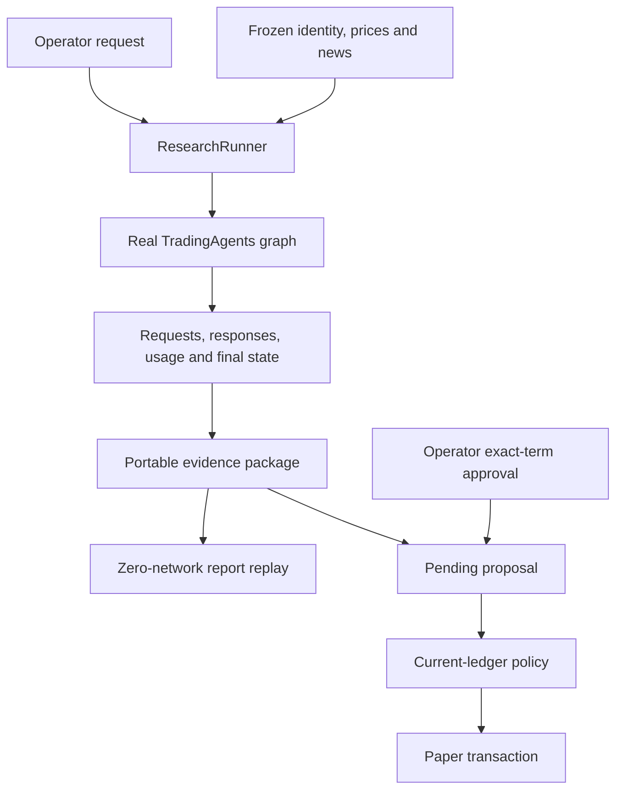

# TradingAgents Research Desk

## Project and participant record

CS5351 Agentic Software Engineering Project. Team: **Alfa, Bravo, Charlie and Delta**. The implementation extends official TradingAgents **v0.4.0**. Repository: [Fighterforever/cs5351-tradingagents-research-desk](https://github.com/Fighterforever/cs5351-tradingagents-research-desk), public.

| Member | Primary responsibility | Relative contribution |
|---|---|---:|
| Alfa (Liyu MA, 59072966) | Requirements, acceptance criteria and report integration | 1.0 |
| Bravo (Xinyao HENG, 60106154) | Architecture, context budgets and GitHub release governance | 1.0 |
| Charlie (Yinuo Li, 60980401) | Evidence, proposal state and reproducible packaging | 1.0 |
| Delta (Chengru WANG, 60254685) | Unit tests, research evaluation and CI gates | 1.0 |

The team allocates equal responsibility across these four areas, with a mean weight of 1.0. Charlie uses the GitHub account [nicolas393](https://github.com/nicolas393). The closing review rotates each area to the next member as set out in docs/process/team.md. Archived development sessions and approvals retain their original operator identifier, leo.

Research Desk addresses two questions. Can an operator trace a recommendation back to the market evidence and control its effect on a paper account? Can the research graph use fewer tokens while preserving report quality? The paper ledger addresses the first question. The six-company experiment addresses the second.

OpenCode generated the application, tests and CI code. The coordinating workflow issued implementation prompts, checked interfaces and ran the experiments. Liyu MA (59072966) used the name leo for project decisions. The [development record](transcripts/59072966-Liyu-MA.md) locates 30 implementation directives across 11 OpenCode sessions. The [supervision index](transcripts/supervision-index.md) pairs five sessions with annotations and links the student decisions and Delta’s independent release review.

## 1. Problem, scope and contribution

TradingAgents is a substantial existing multi-agent application. It already separates research perspectives, produces structured decisions and retains research memory. Its reports are valuable to a reader, but an engineering assessment needs additional evidence about how a particular report was produced and what an application may do with it. A saved report alone does not identify every material input or establish that a later action followed the user's approval.

Research Desk adds four operator functions to TradingAgents. FR-001 exports a research run and rebuilds its report offline. FR-002 lets an operator review exact terms and execute a permitted paper transaction. FR-003 compares the cost and quality of two context strategies on the same evidence. During the submission revision, FR-004 gave saved-package registration a separate acceptance criterion. An operator can reopen the package and recover the ledger’s decision. A change in material evidence on an open proposal requires a fresh review. The other two increments bound model inputs and check quality before release. The [requirements map](docs/process/team.md) links each increment to its evidence.

The evidence workflow answers the operator's question, “What did this run actually see?” Its package records instrument identity, analysis cutoff, material tool inputs, model requests, model responses and terminal state. Actual provider usage accompanies the calls. The package can be exported as a ZIP and inspected on another machine. The replay path reconstructs saved results, so it has no reason to instantiate a model client. A controlled rerun has a different purpose: it executes the research graph again against the same frozen data, allowing an experiment on context strategy.

In the paper ledger, the operator chooses a quantity and reviews the proposed trade. The approval record binds the trade terms. Execution checks the current cash balance and holdings. Repeating the execute command against a completed record returns its original transaction. Section 10 describes what happens when a saved proposal reaches the registration path again.

The context workflow asks whether repeated prompt material can be reduced without damaging evidence-grounded research. The complete selected upstream graph remains in place for both arms. The same DeepSeek model and inference settings are used. The source corpus is fixed before the comparison. Actual token usage supplies the cost measure, while an independent assessment supplies the quality measure. The request budget also provides a concrete degraded-mode behavior: a stopped research run remains inspectable but does not create an approvable recommendation.

The scope deliberately fits a single local operator. The application handles US equities with the market and news analysts, retains the downstream researcher/trader/risk roles, and produces English reports. It offers CLI commands and readable report artifacts. It operates strictly on a local paper ledger without broker integration or live order routing, keeping the execution safety boundary deterministic and testable.

## 2. Existing-system analysis and baseline selection

The baseline is the official v0.4.0 code from TauricResearch/TradingAgents. The initial checkout used the release branch named v0.4.0. Release preparation fetched the complete ancestry and the actual signed upstream v0.4.0 tag, then verified that its source tree was identical to the code tested and extended here. The provenance record is docs/process/upstream-baseline.json. Because the upstream release was new on the execution date, the project pins the signed tag and establishes an explicit local regression baseline.

Source analysis identified the actual extension contracts. TradingAgentsGraph accepts selected analysts, configuration and callbacks. Its propagation path returns a terminal graph state and a signal. The report writer consumes that saved state. Instrument resolution and returns reads include direct data paths that are not ordinary model tool calls. The dependency declarations and provider adapters were also examined before selecting how the extension would access DeepSeek.

Baseline inspection established the extension points provided by TradingAgents. Research Desk reuses its research and persistence contracts, including structured decisions and date-aware memory. Upstream checkpoint and market-data support remain in place, together with callback token accounting. Research Desk connects portable evidence to deterministic proposal review and measures the cost of context control. The requirements registry links inherited capabilities directly to upstream source paths and maps new workflows to extension modules.

The unmodified upstream test run completed with **649 passed, 2 skipped and 71 subtests passed**. The saved log records the invocation and result. The skips concerned an optional AWS dependency and a live DeepSeek integration test that was not given a key in that baseline invocation. The extension retains the full original tests directory. Later regression checks run both the upstream suite and the additional application tests.

The repository layout preserves upstream source and licensing. New application modules live under src/research_desk. New deterministic tests live under test/offline, and API-dependent experiment assets are separated from them. The Python environment belongs to this project. Installing its dependencies does not change the environment used for the separate course assignments. This isolation matters because dependency changes can otherwise create failures in work that the project did not modify.

A real extension also needs to be installable. The first generated slice created its modules but initially omitted the necessary src-layout package-discovery configuration. The CLI then failed to import the package. OpenCode corrected the package discovery configuration in pyproject.toml, restoring the installed research-desk CLI entry point.

## 3. Requirements engineering and acceptance strategy

The machine-readable product requirements document identifies the user and the integrated application workflows. The registry now contains 25 requirements. The first review classified 24. FR-004 was added under [ADR-005](docs/architecture/adr/005-submission-contracts.md) when repeat registration exposed a separate state-recovery requirement. Each entry has an identifier, type, statement, priority and a fit criterion expressed as a metric, comparison operator, threshold and verification method. Source links identify inherited behavior. Component and test references make the registry useful to implementation and CI rather than merely readable prose.

The priorities follow MoSCoW. Correct evidence handling, deterministic authority and complete measurement are Must requirements. A 20% token reduction and a compact wall time within 110% of baseline are Should targets. This prioritization decouples deterministic safety enforcement from empirical optimization targets during acceptance evaluation.

The strongest invariants have zero-tolerance fit criteria. Every ledger mutation must refer to exact approved terms and passing current-state policy checks. An unapproved, rejected, nontradeable or policy-violating proposal must leave the ledger unchanged. The graph must not gain execution authority from text in a report. No request may begin after the configured call limit, making each invariant directly testable through observable failure states.

The fixed teaching policy starts with USD 100000 cash. Quantities are positive whole shares. Shorting is forbidden. A purchase may not leave one stock above 10% of portfolio equity. The price comes from research evidence; the operator cannot type a favorable execution price. The operator chooses quantity and approves it. A valid sell can reduce an owned position even when the remaining holding is still above the purchase cap; a sell beyond the holding is rejected. Hold and REVIEW do not produce a tradeable proposal.

Eight acceptance specifications cover the important behavior. AT-01 exports and replays a complete package in a new process, then tests an incomplete package. AT-02 checks source availability, cutoff dates and duplicate handling. AT-03 demonstrates a valid approved transaction and repeat execution. AT-04 covers the forbidden execution cases. AT-05 changes approved terms or current portfolio state before execution. AT-06 exercises the actual request limit and critical context preservation. AT-07 compares six paired research runs. AT-08 exercises the six CI gates and their failure paths.

The first plan and test approval preceded the first recorded implementation event. The revision approval likewise preceded its first source edit. Gate 1 checks both sequences against the approval artifacts and raw session events.

The most useful negative cases correspond to plausible business failures. For example, approving 100 shares at USD 100 in an empty USD 100000 account reaches the cap exactly. An order for 101 shares must fail. However, those two tests alone cannot establish a total-position invariant. The review therefore adds a purchase after an existing position. That example distinguishes a correct holdings cap from an implementation that limits only the latest ticket.

Requirement volatility was controlled by keeping the feature scope fixed while clarifying ambiguous semantics. The project did not add a web application, extra analyst families or brokerage integration during implementation. The significant clarifications were that no-shorting permits valid sales, the cap applies to total holdings, approval includes quantity and evidence identity, and compact must affect actual per-agent inputs. Those clarifications are recorded in ADR-002 and the defect diary. They arose from reading the implementation against the approved behavior.

## 4. Architecture and authority boundaries

The selected architecture adds application-owned seams around the real graph. Three candidates were compared: broad modification of upstream internals, an application extension, and a replacement demonstration graph. The evaluation considered preservation of baseline behavior, deterministic authority, evidence coverage, delivery scope and maintenance. The application extension received the strongest design score because it preserves the real AI system while keeping the new transaction policy outside it.

The architecture has a clear flow. The operator invokes the CLI. ResearchRunner assembles a configured graph and a run recorder. The graph consumes market/news evidence and produces research state. EvidencePackIO saves the material needed for inspection and replay. A completed tradeable result can create a pending proposal. The operator reviews exact terms. Policy evaluates the current ledger. Storage applies a permitted transaction atomically and records its provenance.

Module ownership follows these responsibilities. Models declares the persistent records. Config owns settings and teaching constants. Evidence captures calls and packages them. Graph_adapter owns the narrow integration with upstream. Context owns assembly and compaction. Budget owns request accounting. Review owns proposal transitions, while policy owns deterministic business decisions. Storage owns SQLite persistence. Replay reconstructs saved outputs, and the CLI exposes these capabilities to the operator.

The distinction between policy and storage is important. Policy decides whether the proposed state change is permitted. Storage records that approved change and its result. Neither module asks a model for permission. The graph's available tools contain research capabilities, and no tool grants approval or mutates the ledger. A sentence inside a model report requesting a policy bypass remains text; it is never interpreted as an operator command.

The research graph derives an evidence identifier from the material inputs and stores it on every tradeable proposal. Approval binds that identifier to the trade terms. A change in the evidence, price or approved quantity requires a fresh review. Immediately before execution, the policy checks the current cash balance and holdings. Section 7 checks the stored identifiers against the inputs from all twelve submission runs.

The REVIEW_REQUIRED state is recoverable. The first implementation correctly refused an unapproved execution but then prevented approval after entering the recovery state. That would leave the operator with a safe failure and no practical path forward. The corrected state machine allows the operator to inspect and approve the current terms. The transition tests exercise the review and execution paths for completed and rejected proposals.

Research and ledger memory have separate purposes. Upstream memory supports reflection on earlier decisions. The paper ledger represents approved positions and cash. Capturing the memory used in a research run makes that run inspectable, but a memory entry cannot authorize a transaction. Each evaluation process uses its own application home so experimental state cannot leak between cases. The storage model targets single-operator local CLI execution with isolated per-run application directories.

## 5. Evidence capture, replay and fixed inputs

Evidence capture begins at the real boundaries of the system. Model callbacks can record messages, returned content and reported usage. Tool callbacks can capture arguments and results. They do not automatically observe every data read. Source inspection identified identity resolution and return-history paths that bypass ordinary tool calls. The application subclass explicitly records or freezes these paths, closing a material gap in evidence completeness.

A package contains a manifest, material input snapshot, event stream, call records, usage summary and terminal state. It can include the proposal and presentation metadata. Completion is a structural claim about required records being present and parseable. A package missing a required record must fail replay rather than silently inventing it. Failed research still retains diagnostic evidence, but its incomplete status cannot become an approved recommendation.

Replay reads saved state and reconstructs the reports and structured decision. It does not ask a language model to recreate previous prose. The same package therefore gives an inspectable report even when the API is unavailable. Display timestamps may differ because they describe the reconstruction, while the decision and policy-relevant fields remain stable. The acceptance test starts replay in a fresh process and blocks external access to establish the intended dependency boundary.

A controlled rerun has a different contract. It executes the full research graph again, using fixed non-LLM data. Different context may lead the model to request a different indicator window or select a different valid tool argument. An exact lookup table of old tool calls would answer only the original transcript and return missing data for another valid request. That behavior could confound the comparison. The fixed-data adapter therefore derives valid responses from the same underlying market CSV and source corpus.

The experiment uses six real equity cases. Prices were retrieved from Yahoo Finance through the installed yfinance library and saved as CSV. Source manifests record retrieval time, row count and latest eligible trading date. Official issuer releases provide the news facts. Availability is tied to the issuer's publication date, not the later retrieval timestamp. The inputs were frozen before final comparison and are preserved with their source identities.

| Case | Analysis date | Frozen close, USD | Role in experiment |
|---|---|---:|---|
| AAPL |2026-07-31|308.9100036621094|Development|
| MSFT |2026-07-30|451.1000061035156|Development|
| NVDA |2026-08-27|227.97999572753906|Held out|
| AMZN |2026-07-31|271.5799865722656|Held out|
| META |2026-07-30|539.030029296875|Held out|
| GOOGL |2026-07-23|317.69000244140625|Held out|

The cases include facts that require careful interpretation. Amazon's reported net income includes a substantial other-income component associated primarily with Anthropic. Alphabet's net income includes large unrealized equity gains. Apple's reported margin and earnings include a tariff-refund effect. Microsoft's release distinguishes GAAP and non-GAAP earnings. These features make factual support more meaningful than a check that a report merely contains the right ticker.

The market files contain unmodified historical observations, and optional macroeconomic or prediction-market queries absent from the fixed corpus return an explicit unavailable response so downstream roles reason only over documented inputs.

## 6. Context engineering and request budgets

The context design has six layers. Instrument identity establishes the subject. Standing constraints establish the analysis cutoff and advisory boundary. Retrieved knowledge supplies market and news evidence. Conversation history carries earlier arguments. Structured state supports continuation. The current task tells a specific role what it must produce. These layers are explicit because compression should remove redundancy without losing the task's controlling facts.

The assembly pipeline first filters evidence for eligibility. It then removes repeated material in compact mode, prioritizes essential content and applies a context budget. After compaction, it re-injects critical constraints. Symbol, analysis date, evidence price, source identity and the current task remain visible. Older discussion may be shortened when it repeats facts already present. The compact strategy also requests concise role responses to reduce repeated prose propagated to later roles.

Both arms execute the same selected upstream roles and model settings, with baseline passing the unmodified upstream prompt history and compact applying message deduplication and concise-output rules. The comparison therefore measures a context strategy rather than an architectural reduction in work. Both the input and output sides of provider usage are reported because concise output can affect later input size as well as the current response.

The first generated context implementation focused on past memory. That was a plausible local interpretation of compaction, and its unit tests could demonstrate deduplication. It would provide little benefit in six fresh cases with little memory. The review identified this mismatch before claiming an improvement and directed OpenCode to transform actual per-agent messages. This intervention illustrates why workload analysis matters: a correct local utility can fail to address the dominant cost of the application.

The request budget is an operational constraint. The counter must be checked before a real request starts. Merely recording an exceeded budget after a response would still spend the next call. Callback behavior also matters because some frameworks swallow callback exceptions, and structured-output fallbacks may retry a failed call. The acceptance test therefore exercises the invocation boundary with a fake provider and attempts one call beyond the configured limit.

A budget-stopped run keeps the evidence collected so far and records a distinct terminal outcome. It does not claim completion and does not create a tradeable proposal. A legitimate run that completes on its final allowed call should remain completed; reaching the numeric limit alone is not proof that another request was blocked. This distinction makes stop reasons useful for both the user and the evaluation.

Per-call output limits use the provider parameter contract, while character heuristics guide local context selection. All reported cost comparisons use provider token metadata, with judge usage recorded separately from application runs.

The complete-input budget is enforced immediately before every plain, tool-bound and structured provider invocation. It uses a conservative UTF-8 byte-based estimate with message overhead. The trigger is 72,000 units and the hard ceiling is 96,000. Compaction retains system constraints, the current task and factual evidence, including complete tool-call/result pairs. If essential content still exceeds the ceiling, the run stops and records context_budget_exhausted. The estimate controls admission; provider metadata measures actual token use.

## 7. Verification results and experimental method

Structural checks cover module boundaries and declared contracts. Unit tests exercise the ledger rules, and the paired experiments measure research quality. The submission revision passed 649 upstream tests and 183 extension tests, for a total of **832 tests and 71 subtests**. One optional-dependency test was skipped and one live test was deselected. [Unit run record](evaluation/submission-verification/unit-regression.txt)

The first implementation reached 47 passing extension tests. Subsequent review exposed exact-approval and total-position errors that the original examples missed. The revised cases check rejected-state persistence, stale approvals and valid sales. A separate request-serialization case confirms that both plain and structured model requests carry the effective provider settings.

### First evaluation and revision

The first two-case development comparison reduced tokens by 36.07%, but both modes lacked counted citations. That result prompted a common grounding layer at every model request. The next complete comparison used 623,270 baseline tokens and 338,250 compact tokens, a 45.73% reduction. Mandatory report checks passed 59/60: META compact omitted the full legal company name. Review also found a quarterly-EPS ratio described as trailing P/E. Those outputs remain under evaluation/final and motivated the general output contract and stricter semantic rubric in ADR-004.

The original experiment used AAPL and MSFT for development and held out four companies. Both subsequent releases used all six companies as a fixed regression corpus.

The first revision matrix exposed a provider transport mismatch. The endpoint returned reasoning despite the standard thinking-disabled flag, and all twelve judge responses reached their output limit before emitting a structured score. A direct parameter diagnosis showed that this endpoint honors reasoning_effort set to none. OpenCode applied that setting to the shared request body. The failed matrix and diagnosis remain in evaluation/revision-initial. The corrected transport was then used for a complete new matrix.

### Previous release experiment

In the release preceding ADR-005, each case ran once in baseline and once in compact mode through the complete selected TradingAgents graph. Both arms use deepseek-flash through the authorized AioHub endpoint, a 1,800-token output cap and the same effective non-thinking settings. The call limit is 32. Each case runs baseline before compact; six independent case workers use separate application homes. The measured durations include provider waiting time.

The frozen CSVs and official company releases are identical across modes. Compact applies its input transformation and a 600-token response target. Baseline retains its original history. Both receive the same factual grounding and financial-period rules. The request delegate also enforces the 96,000-unit complete-input ceiling with a 72,000-unit compaction trigger.

A separate evaluator receives the report with role headings and all captured tool observations. It has no baseline/compact label. The rubric requires support and relevance of at least 0.8 and valid-citation rate of at least 0.95. It explicitly rejects wrong earnings periods, unit conversions and unsupported numerical valuation assertions. Each report must also pass five deterministic identity/date/decision/price/source checks. Support and relevance drops are evaluated separately, with a maximum permitted mean decline of 0.05.

Each run and judgment recorded the model configuration and the source used for that release. Gate 4 recomputed the deterministic checks from the saved packages and read each judgment independently. At the time, the source record covered the extension’s Python source and versioned prompts, as well as the dependency files and frozen market inputs. The release met the mandatory quality and retention thresholds and the COST-001 and PERF-001 targets.

### Measured cost before ADR-005

All twelve corrected runs completed and exported complete packages.

| Case | Baseline tokens | Compact tokens | Reduction | Baseline seconds | Compact seconds |
|---|---:|---:|---:|---:|---:|
| AAPL | 97,897 | 60,512 | 38.19% | 170.401 | 105.167 |
| MSFT | 97,759 | 61,013 | 37.59% | 166.172 | 94.243 |
| NVDA | 102,425 | 64,517 | 37.01% | 171.538 | 99.396 |
| AMZN | 98,011 | 50,738 | 48.23% | 174.900 | 90.754 |
| META | 98,516 | 50,153 | 49.09% | 181.870 | 101.936 |
| GOOGL | 95,176 | 49,222 | 48.28% | 162.759 | 89.330 |

| Measure | Baseline | Compact |
|---|---:|---:|
| Input tokens | 481,193 | 288,214 |
| Output tokens | 108,591 | 47,941 |
| Application tokens | 589,784 | 336,155 |
| Model calls | 80 | 75 |
| Summed application seconds | 1,027.640 | 580.826 |

Compact reduced total application tokens by **43.00%**, exceeding the 20% target. Its elapsed-time sum was **56.52%** of baseline, meeting the maximum ratio of 1.10. These are per-run durations summed across cases; the workers ran concurrently. Judge calls and failed development attempts are accounted for separately.

The final ratings, shown as baseline / compact, were AAPL: Hold / Hold; MSFT: Overweight / Overweight; NVDA: Overweight / Overweight; AMZN: Overweight / Overweight; META: Hold / Underweight; GOOGL: Overweight / Underweight. Four of six cases agreed. The differing META and GOOGL ratings are retained in the evidence. Repeated generation is assessed against factual support and policy boundaries.

### Measured quality before ADR-005

| Case | Baseline support | Compact support | Baseline supported cites | Compact supported cites | Mandatory checks |
|---|---:|---:|---:|---:|---|
| AAPL | 0.90 | 0.90 | 40/40 | 40/42 | 5/5 each |
| MSFT | 0.90 | 0.95 | 28/28 | 42/42 | 5/5 each |
| NVDA | 0.90 | 0.90 | 48/48 | 41/42 | 5/5 each |
| AMZN | 0.90 | 0.90 | 28/28 | 28/28 | 5/5 each |
| META | 0.90 | 0.90 | 40/42 | 41/42 | 5/5 each |
| GOOGL | 0.90 | 0.90 | 47/48 | 27/28 | 5/5 each |

All reports passed the semantic validity check with empty semantic-error lists. All relevance scores were 0.95. Mean support increased from **0.9000** to **0.9083**. Every individual valid-citation rate met 0.95. Mandatory checks passed **60/60**. The report header supplies the legal company name and analysis date from captured evidence. The generated narrative states the frozen closing price and source ID; the saved final state supplies the decision.

Citation counts describe the claims assessed by the evaluator. Its raw explanations identify unsupported and uncited claims. The twelve judge calls for that release consumed **264,309 tokens**, recorded separately from application research. The release validator passed every Must check and all four numerical optimization targets.

### Recorded replay and deterministic stopping

Twelve independent CLI replay processes reconstructed those archived packages without provider credentials. Every replay preserved the original signal and reported zero external calls. The maximum elapsed time was **0.9119 seconds**, including process startup, below the 2.0-second requirement. Commands and outputs are in evaluation/replay-release. A later [offline check](evaluation/replay-review/observations.json) replayed the same twelve packages in fresh processes with an empty USD 100,000 ledger. All signals matched. The network guard recorded no connection attempts. Nine proposals had no quantity and three runs produced Hold. The displayed purchase limits matched the independently calculated limits for that ledger. The release archives contain no policy output from an identical starting ledger for historical comparison.

The original live call-budget demonstration remains in evaluation/budget-stop. It made exactly one request, recorded 2,273 tokens, then stopped before a second request. The exported diagnostic package had no tradeable signal. The current complete-input tests additionally cover threshold compaction, protected evidence and paired tool messages. If mandatory content exceeds the hard cap, the provider is never invoked.

### Submission release after ADR-005

Each company ran once in each mode with the same frozen inputs and the same `deepseek-flash` configuration. Gate 4 checked each run and judgment against the extension, the upstream TradingAgents source and the prompt snapshots used by this revision. [Paired research runs and judgments](evaluation/submission-release)

| Measure across six companies | Baseline | Compact |
|---|---:|---:|
| Application input tokens | 490,883 | 296,256 |
| Application output tokens | 109,693 | 49,053 |
| Total application tokens | 600,576 | 345,309 |
| Model calls | 82 | 75 |
| Sum of run durations (s) | 1,006.253 | 489.513 |
| Mean support | 0.9000 | 0.9250 |
| Mean relevance | 0.9500 | 0.9583 |
| Lowest valid-citation rate | 0.9500 | 0.9524 |

Compact used **42.50% fewer application tokens**. Its summed run time was **48.65% of baseline**. Both figures met the project targets. Each of the twelve reports passed the semantic and quality checks. All **60/60** required fields matched the saved evidence. The twelve judgments consumed a further **264,532 tokens**, excluded from the application totals. The release gate passed without warnings. [Release gate and per-company measurements](evaluation/submission-release/aggregate/release-gate.json)

The two modes agreed on five ratings. Both rated AAPL and META Underweight and rated MSFT, NVDA and AMZN Overweight. For GOOGL, baseline returned Hold and compact returned Overweight. The eleven tradeable decisions each produced a proposal whose stored evidence identifier matched the identifier recomputed from the saved material inputs. The GOOGL baseline run produced no proposal. [Baseline GOOGL evidence](evaluation/submission-release/GOOGL/baseline/run) · [Compact GOOGL evidence](evaluation/submission-release/GOOGL/compact/run)

Replaying each package in a fresh process reproduced all twelve saved ratings and reports. Seven decisions supported a purchase, four supported a sale and one called for no trade. Replay made no external connection attempts and left every ledger row unchanged. The slowest run took 0.7922 seconds. The two NVDA proposals used the exact price in the archived market CSV. The separately parsed case registry differed in the last binary digit, with the same displayed price and share limits. [Independent replay observations](evaluation/submission-verification/replay.json)

## 8. Coding governance and CI/CD

The coding contract starts with AGENTS.md and Prompt.md. OpenCode generates application code and tests within declared module ownership. The static launch prompt requires an execution plan and approved acceptance cases before implementation. Changes to deterministic authority are tied to an accepted ADR and a scoped approval record.

The installed configuration gives plan, build and verify roles separate permissions. Protected policy and governance files remain outside the build role. The temporary revision role was removed at source freeze. A real earlier permission probe rejected a protected-file write. The permission checker validates the installed configuration against the official vendored schema and its reviewable manifest.

The public GitHub repository runs six required checks from .github/workflows/ci.yml.

| Gate | Merge condition |
|---|---|
| Prior test approval | An approval entry covers changed behavior, refers to existing tests and predates the first implementation commit |
| Static and authority checks | Lint, types and permission checks pass. Safety changes also undergo a public interface check and require an accepted ADR |
| Requirements schema | All 25 current entries satisfy the schema and trace matrix |
| Semantic evaluation | Fixed offline replay and current-source paired research meet declared thresholds |
| Regression | Preserved upstream tests and all extension unit tests pass |
| AI-use log | A new or amended log entry covers each changed code or prompt path and points to evidence |

Branch protection requires these checks and one approving review. Code-owner review applies to safety paths, stale approvals are dismissed, and review conversations must be resolved. The policy applies to administrators and forbids force pushes and deletion. The accepted server configuration is saved in evaluation/github/branch-protection-current.json.

Both the first public cloud execution and the revised source pull request passed all six jobs. The [source revision CI run](https://github.com/Fighterforever/cs5351-tradingagents-research-desk/actions/runs/42645314153) and [PR #1](https://github.com/Fighterforever/cs5351-tradingagents-research-desk/pull/1) provide the release evidence. The earlier private-repository billing and protection responses remain in the historical records. Delta [approved PR #1](https://github.com/Fighterforever/cs5351-tradingagents-research-desk/pull/1#pullrequestreview-5840085663). The PR merged, and all six [main-branch checks](https://github.com/Fighterforever/cs5351-tradingagents-research-desk/actions/runs/42798475065) passed.

CI installs the existing dependency constraints and runs without provider credentials. Gate 4 verifies saved actual research evidence, including provenance from both generation and judgment, while deterministic replay stays offline. Fresh provider evaluation is the explicit release command documented in README.md. This lets CI check the archived release on a runner without provider access.

## 9. Supervised process and improvements

The process began with course-document analysis and existing-source inspection. Requirements and acceptance examples were written before implementation. The coordinating workflow accepted the initial plan and test scope under delegated authority before OpenCode started. The first slice connected evidence, review and a paper ledger so there was an early end-to-end workflow. This reduced integration uncertainty before adding the live experiment. The project then used measured failures and code review to choose the next changes.

OpenCode's first session generated the application and tests. Its raw record includes implementation attempts, test failures and corrections. The coordinating review examined business contracts instead of relying entirely on the agent's success statement. The review caught the difference between a ticket cap and total holdings, the omission of shares from approval binding, and the unintended rejection of all sales. It also noticed that an empty-memory compaction example could pass while delivering no useful savings on the planned workload.

The first session continued cleanup after its offline milestone. The coordinator ended that session and opened a shorter, focused live-evaluation session. This preserved the useful source changes and reduced the cost of repeatedly carrying a large context. The second prompt named the precise defects, fixed corpus, adapter behavior and required live commands. It did not ask the agent to revisit the entire project or produce another broad plan.

Work was divided by ownership to avoid conflicting edits. The core OpenCode session handled application and tests. A separate OpenCode session handled CI scripts and schema. Documentation was maintained alongside the source, and a video workflow captured actual CLI commands in an isolated demo home. The remote repository work waited for a concrete local deliverable. This parallel structure used the API waiting time productively while keeping each code owner bounded.

Early failures concerned packaging, context bookkeeping and a recovery transition. Later review findings concerned business semantics and experimental validity. That progression suggests the implementation became mechanically runnable before it fully represented the approved contracts. The improvement was to move from broad test counts to a smaller number of discriminating examples at each authority boundary.

The team clarified five terms during review. “No shorting” was interpreted as allowing a sell up to owned shares. “Ten percent position” constrains total holdings after a buy, while a valid sale can reduce an overweight holding. ADR-002 requires approval to identify the quantity and material evidence. “Replay” reconstructs a saved result, while “rerun” regenerates one from fixed input. “Token reduction” refers to actual provider usage. These definitions are reflected in the requirements, ADRs and tests so later maintenance does not have to reconstruct the reasoning from a conversation.

Artifacts co-evolved through the trace matrix. A change to the holdings interpretation affected the policy owner, approval decision, test examples and defect diary. A change to the context strategy affected ADR-001, the runtime adapter and evaluation method. Updating the JSON schema ensured that automated validation checked the committed requirements registry, while the AI-use gate verified that session logs stayed synchronized with source and prompt paths.

Governance records specify what an authorized change may do. Test logs and provider metadata show what ran, and GitHub responses show whether the server enforced its release policy.

### Architecture revisions and process cost

The design evolved through five recorded ADD iterations. Each decision changed the component that owns the affected behavior.

| Iteration | Driver | Architectural decision | Evidence |
|---|---|---|---|
| Application composition | Inspectable research with deterministic execution | ADR-001 keeps the upstream graph and adds evidence, review and replay owners | Initial end-to-end workflow and inherited regression |
| Exact approval | Quantity changes and cumulative holdings could bypass the intended rule | ADR-002 binds exact terms and checks current total exposure | Stale-approval, second-buy and valid-sale unit cases |
| Effective permissions | A reviewable manifest alone did not configure the running agent | ADR-003 installs root role permissions and exact shell boundaries | Schema validation and real denied-write probe |
| Source-bound quality | Output defects and stale evidence could survive an offline replay | ADR-004 adds report identity, whole-input limits and current-source acceptance | 60/60 mandatory fields in the pre-ADR-005 release |
| Evidence and ledger continuity | Research proposals lacked material evidence IDs, and repeat registration could overwrite an operator decision | ADR-005 binds proposals to the research inputs, preserves ledger decisions on registration and checks every release pair | All 11 submission proposals matched their saved inputs. [Registration and recovery tests](test/offline/test_submission_runtime.py) cover changed evidence and repeat registration. |

A paired coding experiment reproduced the rejected-proposal defect in two isolated copies. Both OpenCode runs received the same repair request, model and acceptance cases. The broad condition included the changed owner and surrounding project modules. The focused condition retained the owner, its model/policy/storage dependencies and the same acceptance tests. Both returned a replacement execute function, which was applied only to its isolated copy.

| Coding context | Input including cache | Output tokens | Total observed tokens | Existing unit cases |
|---|---:|---:|---:|---:|
| Broad | 52,651 | 7,758 | 60,409 | 26 passed |
| Focused | 20,005 | 3,714 | 23,719 | 26 passed |

Focused context reduced input tokens by **62.00%** and total observed tokens by **60.74%**. Both patches retained the tested approval and execution behavior. The comparison measures one paired maintenance task. Its exact prompts, native usage counters and generated functions are in evaluation/development-cost/context-study, with complete OpenCode session exports in transcripts.

Cached input remains part of the context processed by the model and is included in this comparison. The session counters retain uncached input, cache reads and output separately. These measurements support a concrete workflow change: supply the current owner and its declared dependencies first, then expand context when the task requires it. Broad repository exploration remains useful during initial architecture analysis.

## 10. Scope and further work

Research Desk is a single-operator paper application. A networked deployment would require authenticated identities and a separate concurrency design. Broker execution and transaction costs are outside the implemented workflow.

The six-case corpus measures regression behavior on fixed evidence. The judge's raw explanations remain part of the quality record, alongside deterministic facts. Broader financial coverage would require additional reserved cases and repeated trials. Provider or upstream changes reopen the adapter contract and trigger a new complete evaluation.

The release before ADR-005 produced nine tradeable proposals with an empty evidence identifier. The [submission review](docs/review-memo.md#submission-review) traced the gap to the graph-to-approval path. It also identified a registration path that could replace a terminal ledger state and a replay command that could report success after a file-write error. [ADR-005](docs/architecture/adr/005-submission-contracts.md) specifies the repairs and the acceptance conditions for this revision.

The context study in Section 9 examines a defined maintenance task. Future development can repeat that comparison across larger architectural changes to measure how context selection affects both token cost and defect rates.

## 11. Contributions and individual reflections

### Contribution record

Liyu MA confirmed that the four members contributed equally and accepted the reflections in this section. Each final weight is 1.0, giving a team mean of 1.0. [Team contribution record](transcripts/leo-project-directions.md#u-13--architecture-discussion-and-final-contributions). Liyu MA supplied the [project directions](transcripts/leo-project-directions.md), including scope, publication, the four-person allocation and the latest repair request. The group supplied the formal names and student numbers for the four roles. The [OpenCode implementation directives](transcripts/supervision-index.md) record instructions sent by the coordinating workflow.

| Working name | Work linked to the member |
|---|---|
| Alfa (Liyu MA, 59072966) | Liyu MA advocated preserving the upstream research graph. As leo, Liyu MA set the project scope, authorized the public repository, requested source-linked supervision evidence and directed the latest contract repairs. Liyu MA also recorded the English narration and requested a legibility and timing review. The final video holds the transaction receipt and balance on screen during the corresponding explanation. [Demonstration review](transcripts/leo-project-directions.md#u-12--review-the-separate-demonstration). |
| Bravo (Xinyao HENG, 60106154) | During architecture selection, Xinyao HENG compared placing capture points in the upstream graph with capturing evidence in an outer wrapper, and advocated the first option. The [candidate comparison](docs/architecture/evaluation-table.md) gave this option its strongest score for evidence capture. [Liyu MA’s account](transcripts/leo-project-directions.md#u-13--architecture-discussion-and-final-contributions). |
| Charlie (Yinuo Li, 60980401) | According to Liyu MA, Yinuo Li checked whether an exported research package replayed offline and whether registering an unchanged proposal again preserved its approval. See the [offline replay case](test/offline/test_at01_replay.py) and the [repeat-registration cases](test/offline/test_submission_runtime.py). |
| Delta (Chengru WANG, 60254685) | Submitted the independent [PR #1 review and approval](https://github.com/Fighterforever/cs5351-tradingagents-research-desk/pull/1#pullrequestreview-5840085663). Approved the scoped plan and kept the four-version matrix advisory until its results could support a blocking policy. Added the matrix and a [supervision write-up](transcripts/60254685-Chengru-WANG.md) in [PR #2](https://github.com/Fighterforever/cs5351-tradingagents-research-desk/pull/2), which remains open. |

The advisory matrix passed on Python 3.12 and 3.13. Installation stopped on 3.10 and 3.11. The [archived write-up](transcripts/60254685-Chengru-WANG.md) records Delta’s decisions on the PR branch. Its original Qoder conversation is held in the member’s client.

### Alfa (Liyu MA, 59072966)

Examining the requirements registry and acceptance specifications in my assigned area reshaped how I think about turning natural-language policy rules into testable software invariants. At first glance, encoding 24 requirements with machine-readable metrics, comparison operators, and MoSCoW priorities looked mainly like traceability bookkeeping to separate zero-tolerance ledger safety rules from empirical targets such as the 20% token reduction and the 110% compact runtime ceiling. Tracing the 10% portfolio equity cap across the initial 47 passing extension tests and the defect diary revealed a much deeper specification lesson. In a USD 100000 paper account, an acceptance pair that approves 100 shares at USD 100 and rejects 101 shares appears to cover the exact boundary. Yet those two isolated checks cannot distinguish a true total-holdings limit from a naive rule that inspects only the current order ticket. A sequential scenario that attempts a second purchase on top of an existing position can show whether the implementation enforces cumulative exposure. Reading ADR-002 alongside AT-03, AT-04, and AT-05 showed me a similar nuance in the no-shorting constraint. An overly rigid guard initially blocked every sale, whereas the actual domain invariant rejects selling beyond owned shares while permitting a partial sale even when the remaining position still sits above the 10% purchase cap. The approval tests gave me a concrete distinction between a changed quantity and a changed balance. The former calls for a fresh decision on the terms. The latter calls for a fresh policy check on the portfolio. Evidence identity adds another requirement: the research path has to supply the identifier that the approval code expects. What stood out to me is that mechanical test counts can climb while core business semantics remain underspecified, especially when an AI coding agent satisfies literal prompt phrasing with the simplest local check. Gate 1 checked the recorded approval and implementation order. The revised acceptance cases made each disputed rule explicit before the next round of edits. Going forward, I will write stateful multi-step negative test sequences that exercise cumulative state transitions and valid recovery paths before implementation starts. I would pair each sequence with a case that should succeed.

### Bravo (Xinyao HENG, 60106154)

Studying the extension architecture and context-engineering pipeline in my assigned scope clarified how a local optimization can miss the bottleneck in the full workload. Wrapping the upstream TradingAgents graph behind narrow adapters kept deterministic policy and SQLite storage completely outside model tool authority, ensuring prose inside an analyst report could never trigger a ledger mutation. Within that boundary, context management posed a subtler engineering problem. The initial generated compaction utility deduplicated historical memory across runs and passed its local unit tests, yet inspecting the actual six-case equity workload exposed a critical mismatch because fresh evaluation runs start with almost no prior memory. A locally valid utility left the real token bottleneck untouched, which lay in the growing per-agent conversation transcript passed along the graph. Restructuring the six-layer context pipeline to deduplicate active message history, apply a 600-token response target in compact mode, and explicitly re-inject symbol, analysis date, frozen closing price, source identity, and task constraints after compression reduced total application tokens by 43.00% from 589,784 to 336,155 and cut summed elapsed time to 56.52% of baseline without degrading support scores. Equally instructive was where budget enforcement lived. Checking request or context limits inside post-response callbacks can fail when frameworks swallow callback exceptions or retry structured outputs. Enforcing the 32-call ceiling and the 72,000-unit compaction trigger with a 96,000-unit ceiling on the conservative UTF-8 estimate immediately before every plain, tool-bound, and structured provider call gave the application a precise point to stop and keep an incomplete result out of the proposal workflow. The same principle appeared in release and coding governance, where ADR-003 moved agent permissions from a passive manifest into enforced root configuration validated against the vendored schema and a real denied-write probe, while a paired maintenance experiment cut observed coding tokens by 60.74% from 60,409 to 23,719 by supplying only the target module and its declared model, policy, and storage dependencies. Moving forward, I will profile where state and cost actually accumulate in an end-to-end workload before designing optimizations, and I will place admission checks and invariant re-injection directly at outbound execution boundaries.

### Charlie (Yinuo Li, 60980401)

Analyzing the evidence-capture, replay, and proposal-state mechanisms in my assigned area highlighted how easily reproducibility and state-machine usability break at hidden boundaries. A portable evidence package appears straightforward if you assume framework model and tool callbacks observe every external read. Source inspection of the upstream graph revealed identity-resolution and return-history code paths that bypassed ordinary tool invocations entirely. Explicitly capturing and freezing those paths in the application subclass closed a silent completeness gap, allowing twelve independent CLI replay processes to reconstruct saved reports and structured decisions in at most 0.9119 seconds in the recorded timing runs. Those commands reported zero external calls. A separate fixture test blocked socket access, and the replay path rejected incomplete packages. Comparing zero-network replay against controlled experimental reruns exposed an equally important data-contract distinction. Because compact prompts can lead an agent to request a different valid technical-indicator window than baseline, caching a literal lookup table of previous tool arguments would fail on legitimate new queries and confound the comparison. Deriving responses dynamically from frozen Yahoo Finance CSVs and official issuer releases gated by publication date rather than retrieval timestamp kept the fixed inputs reproducible across valid queries, while returning explicit unavailable markers for uncaptured macroeconomic queries. A parallel lesson emerged in the proposal state machine between review, policy, and storage. The approval tests caught changes to quantity and price. The unit fixtures supply an evidence identity. The research graph must supply that same field for the approval record to identify the underlying evidence. The execution path reads the current portfolio before writing to SQLite. The evaluation runs used separate application homes to keep their state independent. However, the first implementation of the REVIEW_REQUIRED state refused unapproved execution and then locked the proposal without a path to approve the revised terms, turning a safety guard into an operational dead end. The transition fix restored review of the corrected terms. The tests exercised review and execution directly, leaving the registration path outside that check. In future systems work, I will audit framework observability hooks directly against upstream read paths, back deterministic reruns with queryable frozen datasets instead of transcript caches, and test complete operator recovery sequences.

### Delta (Chengru WANG, 60254685)

Writing the independent review memo and submitting the approving review for PR #1, followed by opening PR #2 with an annotated supervision write-up and an advisory Python version matrix, gave me a concrete view of how CI verification catches hidden environment and evaluation assumptions. My PR #1 review checked how the six blocking jobs relate to their scripts. The project test record shows 790 tests and 71 subtests passing. CI supplied the regression outcome while the review memo recorded the scope of the manual inspection. Gate 4 connects the report checks to the source and recorded model settings. The release evidence passed 60 out of 60 mandatory field checks. It also records the thresholds of 0.80 for support and relevance and 0.95 for valid citations. Keeping the 264,309 judge tokens separate from the application counters made the reported compact cost savings easier to interpret. The earlier failed run shows how transport can affect evaluation. Twelve judge responses reached the output limit before producing structured scores. The provider diagnosis isolated the effective setting, and the following matrix used the corrected request body. Preparing the still-open PR #2 taught me two further lessons in my own work. First, adding the advisory version matrix revealed that passing CI runs on Python 3.12 and 3.13 did not extend to older releases, because Python 3.10 and 3.11 both stopped during dependency installation under the existing dependency constraints. Second, submitting the supervision write-up in PR #2 without including the raw Qoder session log showed me what a summary can leave out. The original session would let a reviewer check the order and wording of the interventions. Reviewing PR #1 and building PR #2 showed me that trustworthy continuous integration depends on a reproducible environment and traceable evidence as well as the unit tests. In future projects, I will validate dependency installation across an explicit interpreter matrix before assuming multi-version compatibility and archive raw AI session transcripts alongside every pull request from the start.

## 12. Reproducibility and deliverable map

The complete D1–D9 path index is docs/deliverable-index.md. The repository contains the requirements registry and JSON schema under docs/req. Architecture artifacts include the root blueprint, ADRs, invariant register, trace matrix, memory design, permission model, runtime policy catalog and candidate evaluation. Governance files include AGENTS.md, Prompt.md, project rules, structural constraints and verification constraints. The review memo, debt register and defect diary preserve significant decisions and findings.

Source is under src/research_desk and the original upstream directories remain intact. Deterministic tests are under test/offline. Frozen public inputs and recorded fixture packages are identified separately. Live evaluation artifacts contain per-case evidence and aggregated results. The transcripts directory preserves complete native OpenCode sessions, original event streams and annotations. Credential-only redaction is distinguished from optional broadly sanitized convenience exports. The final report is this single Markdown document, with a 12-point single-spaced PDF rendering supplied for page-count inspection. The 600-second MP4 demonstration is a separate deliverable and is not embedded in the source ZIP.

A reviewer should first read the README and run the deterministic suite. The isolated demonstration then shows export, replay, approval, execution and rejection. The live experiment can be repeated with an explicitly provided DeepSeek key and the saved fixed inputs. Repetition may incur API charges and produce different reasoning; the archived original results remain the evidence for this report's numerical claims. The environment lock records the actual installed dependency versions without including local credentials or editable absolute paths.

## References

1. TauricResearch. TradingAgents v0.4.0 source and changelog. https://github.com/TauricResearch/TradingAgents/tree/v0.4.0
2. CS5351. Agentic Software Engineering Project Requirement Sheet, 2026–2027. Supplied course document.
3. Apple. Third-quarter results, July 30, 2026. https://www.apple.com/newsroom/2026/07/apple-reports-third-quarter-results/
4. Microsoft. FY2026 Q4 earnings release. https://www.microsoft.com/en-us/investor/earnings/fy-2026-q4/press-release-webcast
5. NVIDIA. Second-quarter fiscal 2027 results. https://investor.nvidia.com/news/press-release-details/2026/NVIDIA-Announces-Financial-Results-for-Second-Quarter-Fiscal-2027/default.aspx
6. Amazon. Second-quarter results, July 30, 2026. https://ir.aboutamazon.com/news-release/news-release-details/2026/Amazon-com-Announces-Second-Quarter-Results/default.aspx
7. Meta. Second-quarter 2026 results. https://investor.atmeta.com/investor-news/press-release-details/2026/Meta-Reports-Second-Quarter-2026-Results/default.aspx
8. Alphabet. Q2 2026 earnings release. https://s206.q4cdn.com/479360582/files/doc_financials/2026/q2/2026q2-alphabet-earnings-release.pdf
9. Yahoo Finance. Frozen OHLCV retrieved through yfinance 1.7.0; exact retrieval metadata and CSVs accompany the evaluation corpus.
