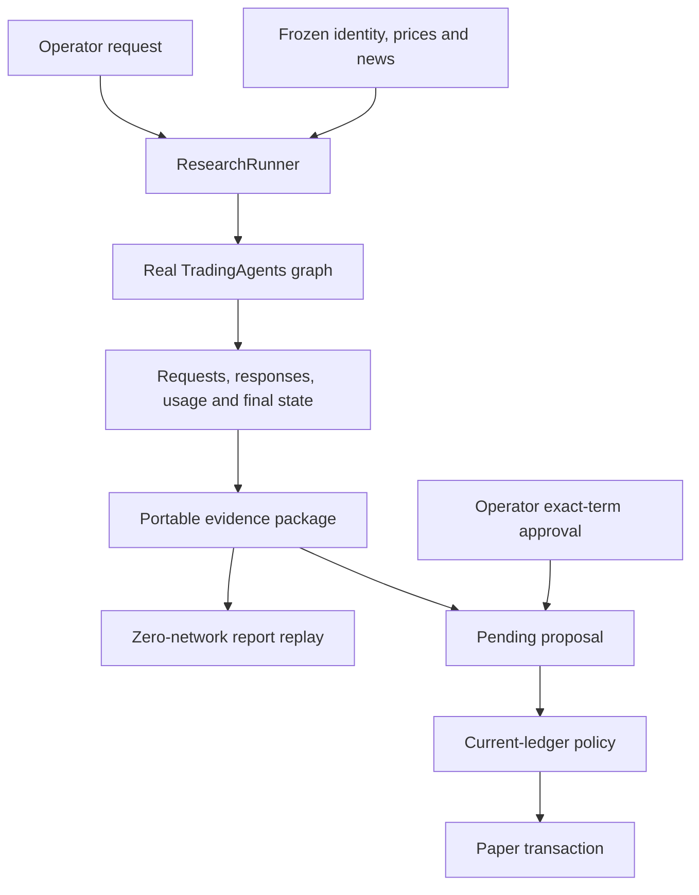

# TradingAgents Research Desk

## Project and participant record

CS5351 Agentic Software Engineering Project. Participant and evaluation identifier: **leo**. Relative contribution: **1.0**. The implementation extends official TradingAgents **v0.4.0**. Repository: [Fighterforever/cs5351-tradingagents-research-desk](https://github.com/Fighterforever/cs5351-tradingagents-research-desk), private.

This project uses a genuine language-model research graph to investigate a practical software engineering question: how can a user inspect the evidence behind an AI recommendation, reproduce its presentation, and control the consequences of accepting it? The delivered workflow connects research to a portable evidence package, then to an explicitly approved paper transaction. A second workflow compares the cost and quality of two context strategies using the same underlying research system.

The project was conducted as a teaching evaluation under the identifier leo. The user authorized autonomous decisions and DeepSeek API execution. OpenCode generated application, test and CI code; the coordinating workflow supplied bounded prompts, reviewed declared contracts, executed experiments and prepared documentation. This provenance statement applies to the decision and reflection records throughout the project. No additional students or university student numbers are invented. The repository preserves the real OpenCode sessions and intervention records.

The report distinguishes the system's research capability from the authority to change paper state. Research can produce useful reasoning while still being uncertain or incomplete. Execution requires an exact approval and a deterministic policy result. The experiment likewise separates measured token reduction from factual quality. A shorter report earns no quality credit simply because it costs less to generate.

## 1. Problem, scope and contribution

TradingAgents is a substantial existing multi-agent application. It already separates research perspectives, produces structured decisions and retains research memory. Its reports are valuable to a reader, but an engineering assessment needs additional evidence about how a particular report was produced and what an application may do with it. A saved report alone does not identify every material input or establish that a later action followed the user's approval.

Research Desk adds three cohesive features. The first captures a run as a transferable evidence package and reconstructs the report in a new process without external calls. The second turns a completed recommendation into an operator-reviewed proposal and applies a paper transaction only after deterministic checks. The third adds context and request-budget controls, then measures a baseline/compact comparison over six fixed cases. Each feature participates in an end-to-end user workflow rather than existing as an isolated demonstration.

The first feature answers the operator's question, “What did this run actually see?” Its package records instrument identity, analysis cutoff, material tool inputs, model requests, model responses and terminal state. Actual provider usage accompanies the calls. The package can be exported as a ZIP and inspected on another machine. The replay path reconstructs saved results, so it has no reason to instantiate a model client. A controlled rerun has a different purpose: it executes the research graph again against the same frozen data, allowing an experiment on context strategy.

The second feature answers, “Which action did I approve?” A proposal includes the research evidence reference, direction, price and operator-selected quantity. Approval refers to exact terms. If those terms change, the old approval cannot authorize the new proposal. The policy checks the current ledger at execution time because the user's earlier review cannot freeze cash or holdings indefinitely. Repeating an already completed execution returns the original transaction instead of applying a second financial side effect.

The third feature asks whether repeated prompt material can be reduced without damaging evidence-grounded research. The complete selected upstream graph remains in place for both arms. The same DeepSeek model and inference settings are used. The source corpus is fixed before the comparison. Actual token usage supplies the cost measure, while an independent assessment supplies the quality measure. The request budget also provides a concrete degraded-mode behavior: a stopped research run remains inspectable but does not create an approvable recommendation.

The scope deliberately fits a single local operator. The application handles US equities with the market and news analysts, retains the downstream researcher/trader/risk roles, and produces English reports. It offers CLI commands and readable report artifacts. It has no broker integration and places no real orders. This boundary makes the safety requirement testable without presenting a classroom paper ledger as a production trading platform.

## 2. Existing-system analysis and baseline selection

The baseline is the official v0.4.0 code from TauricResearch/TradingAgents. The initial checkout used the release branch named v0.4.0. Release preparation fetched the complete ancestry and the actual signed upstream v0.4.0 tag, then verified that its source tree was identical to the code tested and extended here. The provenance record is docs/process/upstream-baseline.json. The release was new on the execution date. The project therefore uses a formal pinned version and establishes a local test baseline instead of describing the release as proven by a long operational history.

Source analysis identified the actual extension contracts. TradingAgentsGraph accepts selected analysts, configuration and callbacks. Its propagation path returns a terminal graph state and a signal. The report writer consumes that saved state. Instrument resolution and returns reads include direct data paths that are not ordinary model tool calls. The dependency declarations and provider adapters were also examined before selecting how the extension would access DeepSeek.

This inspection prevented several false novelty claims. Structured decisions are inherited. Date-aware memory is inherited. Checkpoint and resume behavior is inherited. The verified market snapshot and token-statistics pattern also belong to the upstream project. Research Desk's contribution is the integrated evidence/review/evaluation workflow around those capabilities. The requirements registry lists inherited requirements with source links so a reviewer can distinguish reuse from new behavior.

The unmodified upstream test run completed with **649 passed, 2 skipped and 71 subtests passed**. The saved log records the invocation and result. The skips concerned an optional AWS dependency and a live DeepSeek integration test that was not given a key in that baseline invocation. The extension retains the full original tests directory. Later regression checks run both the upstream suite and the additional application tests.

The repository layout preserves upstream source and licensing. New application modules live under src/research_desk. New deterministic tests live under test/offline, and API-dependent experiment assets are separated from them. The Python environment belongs to this project. Installing its dependencies does not change the environment used for the separate course assignments. This isolation matters because dependency changes can otherwise create failures in work that the project did not modify.

A real extension also needs to be installable. The first generated slice created its modules but initially omitted the necessary src-layout package-discovery configuration. The CLI then failed to import the package. OpenCode corrected pyproject.toml, after which the installed research-desk command ran successfully. This was an integration defect with a clear reproduction, not a reason to replace the application with a standalone script that bypassed packaging.

## 3. Requirements engineering and acceptance strategy

The machine-readable product requirements document identifies the user, scope and three features. A consolidated registry contains 23 requirements. Each entry has an identifier, type, statement, priority and a fit criterion expressed as a metric, comparison operator, threshold and verification method. Source links identify inherited behavior. Component and test references make the registry useful to implementation and CI rather than merely readable prose.

The priorities follow MoSCoW. Correct evidence handling, deterministic authority and complete measurement are Must requirements. A 20% token reduction and a compact wall time within 110% of baseline are Should targets. This distinction establishes a decision rule before observing results. A measured optimization can miss its target without justifying a weaker approval boundary. Conversely, a passing safety test cannot be used as evidence that the context strategy saved tokens.

The strongest invariants have zero-tolerance fit criteria. Every ledger mutation must refer to exact approved terms and passing current-state policy checks. An unapproved, rejected, nontradeable or policy-violating proposal must leave the ledger unchanged. The graph must not gain execution authority from text in a report. No request may begin after the configured call limit. These are operational rules with observable failure behavior, not broad aspirations such as “the system should be safe.”

The fixed teaching policy starts with USD 100000 cash. Quantities are positive whole shares. Shorting is forbidden. A purchase may not leave one stock above 10% of portfolio equity. The price comes from research evidence; the operator cannot type a favorable execution price. The operator chooses quantity and approves it. A valid sell can reduce an owned position even when the remaining holding is still above the purchase cap; a sell beyond the holding is rejected. Hold and REVIEW do not produce a tradeable proposal.

Eight acceptance specifications cover the important behavior. AT-01 exports and replays a complete package in a new process, then tests an incomplete package. AT-02 checks source availability, cutoff dates and duplicate handling. AT-03 demonstrates a valid approved transaction and repeat execution. AT-04 covers the forbidden execution cases. AT-05 changes approved terms or current portfolio state before execution. AT-06 exercises the actual request limit and critical context preservation. AT-07 compares six paired research runs. AT-08 exercises the six CI gates and their failure paths.

The plan and test specifications were approved at **2026-08-31 12:05:17.791955 UTC**. The first recorded OpenCode implementation event occurred at **12:06:32.695 UTC**. The approval file and raw session provide the chronology. A CI gate must validate the dates and referenced tests rather than treating a freely editable APPROVED string as sufficient evidence. The scope of that decision is the three-feature project, not an indefinite authorization to change any future policy.

The most useful negative cases correspond to plausible business failures. For example, approving 100 shares at USD 100 in an empty USD 100000 account reaches the cap exactly. An order for 101 shares must fail. However, those two tests alone cannot establish a total-position invariant. The review therefore adds a purchase after an existing position. That example distinguishes a correct holdings cap from an implementation that limits only the latest ticket.

Requirement volatility was controlled by keeping the feature scope fixed while clarifying ambiguous semantics. The project did not add a web application, extra analyst families or brokerage integration during implementation. The significant clarifications were that no-shorting permits valid sales, the cap applies to total holdings, approval includes quantity and evidence identity, and compact must affect actual per-agent inputs. Those clarifications are recorded in ADR-002 and the defect diary. They arose from reading the implementation against the approved behavior.

## 4. Architecture and authority boundaries

The selected architecture adds application-owned seams around the real graph. Three candidates were compared: broad modification of upstream internals, an application extension, and a replacement demonstration graph. The evaluation considered preservation of baseline behavior, deterministic authority, evidence coverage, delivery scope and maintenance. The application extension received the strongest design score because it preserves the real AI system while keeping the new transaction policy outside it.

The architecture has a clear flow. The operator invokes the CLI. ResearchRunner assembles a configured graph and a run recorder. The graph consumes market/news evidence and produces research state. EvidencePackIO saves the material needed for inspection and replay. A completed tradeable result can create a pending proposal. The operator reviews exact terms. Policy evaluates the current ledger. Storage applies a permitted transaction atomically and records its provenance.

Module ownership follows these responsibilities. Models declares the persistent records. Config owns settings and teaching constants. Evidence captures calls and packages them. Graph_adapter owns the narrow integration with upstream. Context owns assembly and compaction. Budget owns request accounting. Review owns proposal transitions, while policy owns deterministic business decisions. Storage owns SQLite persistence. Replay reconstructs saved outputs, and the CLI exposes these capabilities to the operator.

The distinction between policy and storage is important. Policy decides whether the proposed state change is permitted. Storage records that approved change and its result. Neither module asks a model for permission. The graph's available tools contain research capabilities, and no tool grants approval or mutates the ledger. A sentence inside a model report requesting a policy bypass remains text; it is never interpreted as an operator command.

Approval refers to exact content. A fingerprint is appropriate for this purpose because it detects a changed combination of material evidence and trade terms. The fingerprint does not replace ordinary release or schema versions. After approval, changing quantity or price requires another review. A transaction also rechecks current cash and holdings because an earlier approved action may have changed the portfolio. These checks protect different boundaries: exact-content binding protects the user's decision, and current-state evaluation protects the portfolio invariant.

The REVIEW_REQUIRED state is recoverable. The first implementation correctly refused an unapproved execution but then prevented approval after entering the recovery state. That would leave the operator with a safe failure and no practical path forward. The corrected state machine allows the operator to inspect and approve the current terms. Completed and rejected proposals retain their explicit business meaning. The state-machine tests cover recovery rather than merely asserting that an error occurs.

Research and ledger memory have separate purposes. Upstream memory supports reflection on earlier decisions. The paper ledger represents approved positions and cash. Capturing the memory used in a research run makes that run inspectable, but a memory entry cannot authorize a transaction. Each evaluation process uses its own application home so experimental state cannot leak between cases. The application does not claim multiuser service semantics; its supported workflow is a single operator using a local CLI.

## 5. Evidence capture, replay and fixed inputs

Evidence capture begins at the real boundaries of the system. Model callbacks can record messages, returned content and reported usage. Tool callbacks can capture arguments and results. They do not automatically observe every data read. Source inspection identified identity resolution and return-history paths that bypass ordinary tool calls. The application subclass explicitly records or freezes these paths, closing a material gap in evidence completeness.

A package contains a manifest, material input snapshot, event stream, call records, usage summary and terminal state. It can include the proposal and presentation metadata. Completion is a structural claim about required records being present and parseable. A package missing a required record must fail replay rather than silently inventing it. Failed research still retains diagnostic evidence, but its incomplete status cannot become an approved recommendation.

Replay reads saved state and reconstructs the reports and structured decision. It does not ask a language model to recreate previous prose. The same package therefore gives an inspectable report even when the API is unavailable. Display timestamps may differ because they describe the reconstruction, while the decision and policy-relevant fields remain stable. The acceptance test starts replay in a fresh process and blocks external access to establish the intended dependency boundary.

A controlled rerun has a different contract. It executes the full research graph again, using fixed non-LLM data. Different context may lead the model to request a different indicator window or select a different valid tool argument. An exact lookup table of old tool calls would answer only the original transcript and return missing data for another valid request. That behavior could confound the comparison. The fixed-data adapter therefore derives valid responses from the same underlying market CSV and source corpus.

The experiment uses six real equity cases. Prices were retrieved from Yahoo Finance through the installed yfinance library and saved as CSV. Source manifests record retrieval time, row count and latest eligible trading date. Official issuer releases provide the news facts. Availability is tied to the issuer's publication date, not the later retrieval timestamp. The inputs were frozen before final comparison and are preserved with their source identities.

| Case | Analysis date | Frozen close, USD | Role in experiment |
|---|---|---:|---|
| AAPL |2026-07-31|308.9100036621094|Development|
| MSFT |2026-07-30|451.1000061035156|Development|
| NVDA |2026-08-27|227.97999572753906|Held out|
| AMZN |2026-07-31|271.5799865722656|Held out|
| META |2026-07-30|539.030029296875|Held out|
| GOOGL |2026-07-23|317.69000244140625|Held out|

The cases include facts that require careful interpretation. Amazon's reported net income includes a substantial other-income component associated primarily with Anthropic. Alphabet's net income includes large unrealized equity gains. Apple's reported margin and earnings include a tariff-refund effect. Microsoft's release distinguishes GAAP and non-GAAP earnings. These features make factual support more meaningful than a check that a report merely contains the right ticker.

The market files remain actual observations. Optional macroeconomic or prediction-market information absent from the fixed corpus receives an explicit unavailable response. The adapter must not fabricate a convenient value to keep a role busy. An unavailable source can be discussed as missing evidence, and the resulting report should state what can be concluded from the information supplied. The model's reasoning does not change the provenance of its inputs.

## 6. Context engineering and request budgets

The context design has six layers. Instrument identity establishes the subject. Standing constraints establish the analysis cutoff and advisory boundary. Retrieved knowledge supplies market and news evidence. Conversation history carries earlier arguments. Structured state supports continuation. The current task tells a specific role what it must produce. These layers are explicit because compression should remove redundancy without losing the task's controlling facts.

The assembly pipeline first filters evidence for eligibility. It then removes repeated material in compact mode, prioritizes essential content and applies a context budget. After compaction, it re-injects critical constraints. Symbol, analysis date, evidence price, source identity and the current task remain visible. Older discussion may be shortened when it repeats facts already present. The compact strategy also requests concise role responses to reduce repeated prose propagated to later roles.

Baseline preserves the original substantive input and follows the same graph. It is not padded with duplicate text to manufacture a favorable comparison. Compact retains all selected roles and uses the same model settings. The comparison therefore measures a context strategy rather than an architectural reduction in work. Both the input and output sides of provider usage are reported because concise output can affect later input size as well as the current response.

The first generated context implementation focused on past memory. That was a plausible local interpretation of compaction, and its unit tests could demonstrate deduplication. It would provide little benefit in six fresh cases with little memory. The review identified this mismatch before claiming an improvement and directed OpenCode to transform actual per-agent messages. This intervention illustrates why workload analysis matters: a correct local utility can fail to address the dominant cost of the application.

The request budget is an operational constraint. The counter must be checked before a real request starts. Merely recording an exceeded budget after a response would still spend the next call. Callback behavior also matters because some frameworks swallow callback exceptions, and structured-output fallbacks may retry a failed call. The acceptance test therefore exercises the invocation boundary with a fake provider and attempts one call beyond the configured limit.

A budget-stopped run keeps the evidence collected so far and records a distinct terminal outcome. It does not claim completion and does not create a tradeable proposal. A legitimate run that completes on its final allowed call should remain completed; reaching the numeric limit alone is not proof that another request was blocked. This distinction makes stop reasons useful for both the user and the evaluation.

Per-call output limits use the actual provider contract. The project does not treat a rough character-to-token estimate as measured API usage. Character estimates can help select context, but the report's cost comparison comes from actual usage metadata. Judge calls are separately recorded. A reduction in application tokens is therefore not inflated by omitting the cost of quality evaluation from the evidence record.

## 7. Verification results and experimental method

Verification has three tiers. Structural checks cover installation, module contracts, permissions, requirement schema and static analysis. Regression checks run all earlier test suites. Behavioral checks exercise the approval boundary, evidence replay and research quality. These tiers are complementary. An importable package can still have an incorrect holdings cap, and a passing deterministic ledger test says nothing about whether a research report faithfully cites earnings evidence.

The first extension slice converged to **47 passing offline tests**. The saved OpenCode session contains the real failures and fixes. The tests cover the CLI workflow, incomplete package rejection, point-in-time context, approval, denial and recovery. Review after this checkpoint found omitted business semantics and an incomplete experimental adapter. Those findings triggered a focused second implementation round rather than a claim that 47 tests established final acceptance.

A demonstration fixture uses a USD 100 evidence price and a USD 100000 initial account. It is intentionally constructed and identified as a fixture. The recorded CLI workflow first rejects execution without approval. After leo approves 100 shares, execution leaves USD 90000 cash and 100 shares. Repeating the execution returns the same transaction and leaves cash unchanged. A separate 101-share example fails the 10% cap and preserves the original ledger. These commands establish the user-visible workflow without presenting the fixture price as a live market quote.

The fixed research experiment contains 12 application runs: six cases under baseline and six under compact. AAPL and MSFT are the development cases. NVDA, AMZN, META and GOOGL were reserved before final tuning. The same frozen inputs, complete selected graph, DeepSeek model and inference configuration apply to both arms. Each case has a saved outcome, call count, input tokens, output tokens and measured elapsed time. Independent OS processes may run concurrently, but cases do not share application state.

The quality method has deterministic and semantic parts. Identity, analysis date, captured price and recommendation state are checked against the package. Source references must correspond to available corpus evidence. An independent live judge assesses support and relevance using the predeclared rubric, with the same procedure for both arms. A support score of 0.8 requires adequately supported main conclusions without a critical fabrication. A relevance score of 0.8 requires the core stock/date task to be covered with limited irrelevant material.

Citation validity requires a source to support the associated claim, not merely an existing source identifier. Uncited factual claims are reported so that a model cannot improve the citation percentage by deleting citations. The judge receives the fixed evidence and report content, and its raw response remains available. A malformed judgment is an evaluation failure requiring an explicit recovery record. It is never replaced with an invented perfect score.

The first actual AAPL pilot completed all research stages and returned Hold after 15 model calls and 27 tool calls, with 141.522 seconds recorded in the terminal event. Export then failed because the real terminal state contained a LangChain message object. Inspection also found that a broad credential-redaction rule erased numeric token fields. The report and partial event stream survived, but that pilot is excluded from final cost comparisons because its token evidence is incomplete. The repair serializes message structures at the evidence boundary and distinguishes usage counters from authentication tokens. These failures and the successful rerun remain separate artifacts.

The first complete development comparison used AAPL and MSFT. Baseline consumed 183143 application tokens and compact consumed 117078, a 36.07% reduction. Summed application elapsed time fell from 305.710 to 161.133 seconds. Both arms nevertheless produced zero cited claims under the predeclared citation assessment. The comparison therefore did not satisfy QUALITY-002. Its complete packages, reports and raw judge responses remain under evaluation/development-initial.

The failed quality check exposed a request-boundary defect: the initial standing context was not received by every downstream research role. The correction installs the same source and factual-grounding policy on every real request in both arms, preserving baseline history and the existing compact target. Prompt version research-desk-0.1.1 records this change. Development cases are rerun before the remaining four cases are opened. The independent judge rubric and acceptance thresholds remain unchanged. The report input now preserves role/stage headings, omits only an identical duplicate final field, and checks that the expected price actually appears in report text. These measurement corrections strengthen attribution and mandatory-field checking; they do not erase disagreement or rewrite model output. A final measurement correction restored every actual tool result from the saved event stream. The input projection retained only the last result for some repeated tool names, while the canonical events retained them all. Every case was then judged again using the same complete-observation procedure. Prior judgments remain in evaluation/final/judge-before-observation-recovery, and their additional usage is reported separately. No research output, prompt, model or threshold changed during this correction.

The final frozen application matrix completed all 12 runs and exported complete evidence packages. The following table uses actual provider totals and measured application elapsed time. The two development cases and four reserved cases are labeled separately.

| Case | Split | Baseline tokens | Compact tokens | Reduction | Baseline seconds | Compact seconds |
|---|---|---:|---:|---:|---:|---:|
| AAPL | Dev. | 100,482 | 61,449 | 38.85% | 160.488 | 62.515 |
| MSFT | Dev. | 112,274 | 55,068 | 50.95% | 177.466 | 67.709 |
| NVDA | Held out | 108,504 | 62,869 | 42.06% | 171.865 | 67.388 |
| AMZN | Held out | 95,133 | 52,031 | 45.31% | 143.778 | 62.525 |
| META | Held out | 99,863 | 53,160 | 46.77% | 148.863 | 64.081 |
| GOOGL | Held out | 107,014 | 53,673 | 49.84% | 168.453 | 68.227 |

| Measure | Baseline | Compact | Result |
|---|---:|---:|---|
| Input tokens | 518,057 | 297,003 | 42.67% reduction |
| Output tokens | 105,213 | 41,247 | 60.80% reduction |
| Total application tokens | 623,270 | 338,250 | 45.73% reduction |
| Model calls | 88 | 80 | 9.09% reduction |
| Summed application seconds | 970.913 | 392.445 | Compact/baseline ratio 0.4042 |

Total application tokens fell by **45.73%**, exceeding the predeclared 20% target. The elapsed-time ratio was **0.4042**, below the maximum 1.10 target. Both input and output token use fell, and all selected upstream roles remained in the graph. Case processes ran concurrently within each stage; each case ran its baseline before its compact arm. The displayed elapsed values are measured per-run durations and their sums, not a claim about one sequential end-to-end runtime. Judge calls and prior development attempts are excluded from these application totals and recorded separately.

Five of six case ratings agreed across modes. META changed from Hold in baseline to Overweight in compact. AAPL and GOOGL were Hold in both modes; MSFT, NVDA and AMZN were Overweight in both. This difference is retained as part of the controlled rerun result. The experiment does not require the two regenerated reports to make identical recommendations.

The final uniform quality evaluation retained the predeclared rubric and thresholds. Each arm received one new judgment with its complete recorded tool observations. The table reports support scores and the judge’s counted supported/cited claims. Relevance was 1.0 for every report.

| Case | Baseline support | Compact support | Baseline valid cites | Compact valid cites | Mandatory checks |
|---|---:|---:|---:|---:|---|
| AAPL | 0.9 | 0.9 | 30/30 | 20/20 | 5/5 each |
| MSFT | 1.0 | 0.9 | 45/45 | 30/30 | 5/5 each |
| NVDA | 0.9 | 0.9 | 30/30 | 30/30 | 5/5 each |
| AMZN | 0.9 | 0.9 | 30/30 | 20/20 | 5/5 each |
| META | 0.9 | 0.9 | 30/30 | 30/30 | Baseline 5/5; compact 4/5 |
| GOOGL | 0.9 | 0.9 | 30/30 | 20/20 | 5/5 each |

Mean support was **0.9167** for baseline and **0.9000** for compact, a decline of **0.0167**, within the allowed 0.05. Every individual support score exceeded 0.8; every relevance score was 1.0. The judge marked 195/195 baseline cited claims and 150/150 compact cited claims as supported, so every reported valid-citation rate was 1.0 and exceeded 0.95. The compact judgments also retained **19 uncited-claim or verification notes**. These counts describe the judge’s accounting and are not a claim of exhaustive citation coverage.

The deterministic mandatory-field result was **59/60 checks**, with 11 of 12 reports passing all five checks. **QUALITY-001 was not fully met:** the held-out META compact report used META/Meta but omitted the required full legal company name, Meta Platforms, Inc. Its ticker, source data and date were correct. The other mandatory checks passed. The frozen output is retained, and neither a ticker-specific matcher exception nor a post hoc text insertion was used to turn the result into a pass. The cost and timing targets were met numerically, while overall research acceptance retains this explicit mandatory-field gap.

The final 12 judge calls used **241278 tokens**, separate from application research. The 12 judgments before observation recovery used **236462 tokens**, and the initial four development judgments used **55148 tokens**. All three sets remain available. This separates the cost of completed frozen application runs from the extra cost incurred while developing and correcting the measurement procedure.

Twelve independent CLI replay processes then reconstructed the completed packages. Every process exited successfully, preserved its own original signal and reported zero external calls. The maximum measured elapsed time was **0.811354 seconds**, including interpreter startup, imports and report writing, meeting the 2.0-second replay requirement. Each process used an isolated paper home without provider credentials. Existing socket-blocked replay regressions separately establish the no-network dependency boundary. The actual command records and outputs are under evaluation/replay-final. Tradeable reports showed deterministic share/cash bounds but remained unapproved because no operator quantity had been approved; Hold reports generated no trade proposal.

A separate live budget demonstration used max_calls=1. It completed exactly one request with **2273 tokens** and **2.011 seconds** recorded, then refused the next request before it started. The exported package was complete, its outcome was budget_stopped and its signal was null. That diagnostic package could be inspected, but it could not create an approvable recommendation. This demonstration is stored under evaluation/budget-stop and is excluded from the six-case comparison.

The Should targets are evaluated against the saved runs. Total token reduction is one minus compact application tokens divided by baseline application tokens. Quality retention compares the two arms' mean scores, with a maximum permitted decline of 0.05. The wall-time ratio compares measured elapsed time under the disclosed execution conditions. Failures and retries remain in the experiment history. Results from a repaired development run do not justify quietly discarding an unfavorable held-out case.

## 8. Coding governance, CI and repository evidence

AGENTS.md is the single entry point for coding work. It identifies the baseline, reading order, module ownership and verification requirements. Prompt.md asks the coding agent for a concrete plan before code generation and requires a matching approval. Current approval authorizes the recorded scope. Future safety changes require a new ADR and a specific decision. Rules and approval records are owned by leo rather than by the implementation role.

The permission model separates planning, building, verification and release. Planning reads requirements and declared interfaces. Building writes approved application and test paths. Verification reads source and evidence and writes results. Release packages reviewed artifacts and uses the authorized private remote. None of these roles needs to read global credential files. The host injects runtime credentials only into the appropriate child process, and they are excluded from saved evidence and submission artifacts.

The first five inherited capabilities remain covered by the original regression suite. New acceptance tests map through the requirement trace matrix to their enforcing component and runtime record. Each safety invariant has a concrete fallback: unchanged ledger, explicit rejection, REVIEW_REQUIRED, or an incomplete research state. The project records such outcomes so a reviewer can diagnose why an action stopped rather than seeing an undifferentiated error.

The CI design implements six gates. The first validates test approval and chronology. The second runs lint, type and dependency checks and adds checks for safety-relevant changes. The third validates the requirements registry against its schema. The fourth re-evaluates fixed captured evidence against semantic properties for prompt/model changes. The fifth runs all prior regressions. The sixth requires the AI-use log to change when code or prompts change. Negative examples and repaired outcomes provide evidence that these checks can actually reject a change.

An offline semantic replay gate has a precise scope. It can recompute factual and structural properties of committed captured outputs. It cannot establish the quality of a newly generated live answer without calling the model. The release evidence therefore includes the actual paired live evaluation as a separate artifact. The project does not rename a deterministic fixture assertion as a fresh language-model judgment.

The final local gate run passed all six checks. The preserved upstream suite recorded **649 passed, 2 skipped and 71 subtests passed**; the application suite recorded **98 passed**. The six controlled negative examples each triggered the intended real validator rejection. Fixed semantic regression covered four committed packages and all six fixed cases with **zero network attempts**. The complete run took **18.666 seconds**, with command outputs and exact provenance under evaluation/ci.

The initial gate run is retained under evaluation/ci-initial. Its static check exposed an unresolved public JSON Schema reference in offline validation, and its AI-use check identified an omitted test package marker in the declared scope. Both were corrected before the final unified run. These failures demonstrate that the gates inspect the delivered artifacts rather than returning unconditional success. The effective role permissions were installed 2026-08-31 at 13:23:25.861 UTC. A separate real --auto probe had already rejected a protected-file write without creating the file.

The private GitHub repository received main and the actual signed upstream v0.4.0 tag. The [Research Desk gate run](https://github.com/Fighterforever/cs5351-tradingagents-research-desk/actions/runs/33397954871) and [preserved upstream CI run](https://github.com/Fighterforever/cs5351-tradingagents-research-desk/actions/runs/33397954872) were created, but GitHub blocked both before any job step ran because of the account’s payment/spending-limit state. Their failure status is therefore a platform execution block, not a result from running the code. The workflows have not completed remotely.

GitHub also returned HTTP 403 for private branch-protection access and required a qualifying account plan or a public repository. The project remains private, no billing setting was changed, and server-enforced branch protection is not enabled. The intended six required checks are retained in evaluation/github/desired-branch-protection.json. Actual run metadata, annotations and protection responses are under evaluation/github. **D7/GOV-004 remains incomplete** until the account can execute Actions and enable the requested private-repository protection. The passing local gates remain reproducible evidence, with no claim that they substitute for server enforcement.

The repository remains private. The original public repository is retained as upstream, and the private course repository is origin. No changes are pushed to TauricResearch. Source history begins from the real upstream baseline and records the extension with concise meaningful commits. The README explains purpose, architecture, setup and test commands, and links to the real GitHub project. Local check success and server-enforced branch protection are recorded separately.

## 9. Supervised process and improvements

The process began with course-document analysis and existing-source inspection. Requirements and acceptance examples were written before implementation. The initial approved slice connected evidence, review and a paper ledger so there was an early end-to-end workflow. This reduced integration uncertainty before adding the live experiment. The project then used measured failures and code review to choose the next changes.

OpenCode's first session generated the application and tests. Its raw record includes implementation attempts, test failures and corrections. The coordinating review examined business contracts instead of relying entirely on the agent's success statement. The review caught the difference between a ticket cap and total holdings, the omission of shares from approval binding, and the unintended rejection of all sales. It also noticed that an empty-memory compaction example could pass while delivering no useful savings on the planned workload.

The first session continued cleanup after its offline milestone. The coordinator ended that session and opened a shorter, focused live-evaluation session. This preserved the useful source changes and reduced the cost of repeatedly carrying a large context. The second prompt named the precise defects, fixed corpus, adapter behavior and required live commands. It did not ask the agent to revisit the entire project or produce another broad plan.

Work was divided by ownership to avoid conflicting edits. The core OpenCode session handled application and tests. A separate OpenCode session handled CI scripts and schema. Documentation was maintained alongside the source, and a video workflow captured actual CLI commands in an isolated demo home. The remote repository work waited for a concrete local deliverable. This parallel structure used the API waiting time productively while keeping each code owner bounded.

Defect trends are described from actual observations rather than invented issue counts. Early failures concerned packaging, context bookkeeping and a recovery transition. Later review findings concerned business semantics and experimental validity. That progression suggests the implementation became mechanically runnable before it fully represented the approved contracts. The improvement was to move from broad test counts to a smaller number of discriminating examples at each authority boundary.

Ambiguity resolution is explicit. “No shorting” was interpreted as allowing a sell up to owned shares. “Ten percent position” constrains total holdings after a buy, while a valid sale can reduce an overweight holding. “Approval” covers quantity and material evidence. “Replay” reconstructs a saved result, while “rerun” regenerates one from fixed input. “Token reduction” refers to actual provider usage. These definitions are reflected in the requirements, ADRs and tests so later maintenance does not have to reconstruct the reasoning from a conversation.

Artifacts co-evolved through the trace matrix. A change to the holdings interpretation affected the policy owner, approval decision, test examples and defect diary. A change to the context strategy affected ADR-001, the runtime adapter and evaluation method. The schema correction made the machine-readable registry validate the document actually committed, rather than an unrelated example record. The AI-use log points to real sessions and their scopes. No artifact is considered complete merely because its filename matches the course checklist.

The project also separates review authority from outcome evidence. A decision can authorize a plan, but it cannot declare an unrun test successful. An ADR can select an architecture, but it cannot establish measured token savings. A workflow file can define checks, but it cannot prove a server rejected a merge. This separation made the final deliverable more reviewable and prevented documentation from outrunning implementation.

## 10. Limitations and remaining risks

The application is a local teaching research desk. Its approval identity is the local operator identifier and does not provide enterprise authentication. It does not connect to a broker or model real execution costs. Portfolio valuation uses the documented evidence/mark convention, and the workload does not establish multiuser concurrency guarantees. A network service would require a separate architecture decision for identity and transaction isolation.

The six-case experiment evaluates context engineering on a defined frozen corpus. It does not establish investment profitability, general financial forecasting performance or robustness to every future market regime. Cases include actual prices and official releases, but the selected corpus is smaller than an unrestricted research environment. Independent live judgments remain model assessments and are preserved for inspection. Deterministic facts and policy results do not rely on those judgments. In the development MSFT compact report, the model divided the stock price by a single-quarter EPS and labeled the result a trailing P/E. The calculation used visible numbers, but the earnings-period interpretation was wrong. The judge still assigned support 0.9. This concrete failure shows why a passing research-quality threshold does not certify every financial interpretation. A valid citation rate of 1.0 refers only to the claims the judge counted as cited; it is not complete citation coverage or 100% factual accuracy. The raw judgments retain their uncited-claim and verification notes.

The baseline tag was newly released and is supported here by the recorded regression run. Future upstream or provider changes can invalidate adapter assumptions and require another full test cycle. Offline replay establishes reconstruction of captured state, while a controlled live rerun can produce a different recommendation. The private GitHub account currently blocks Actions execution and branch-protection access. The repository and workflow files are published, while server execution and merge protection remain unavailable until the account limitations are resolved.

The project evidence reflects the authorized evaluation workflow under leo. It does not claim the participation of a real three-person student team or human approvals that did not occur. The course's transcript wording varies between one full raw session and five annotated sessions; the submission retains the actual complete sessions and maps their stages without fabricating extra conversations. The exact deployment and experimental outcomes are reported with their saved evidence.

## 11. Reflection: leo, evaluation identifier leo

The most important lesson from this project was that useful supervision concentrates on the meaning of a contract. The coding agent quickly produced a large runnable slice, and the first successful test run created a natural temptation to treat the implementation as finished. Reading the actual policy showed why that would have been premature. A limit on one purchase looked similar to a limit on the resulting holding, yet the two rules permit different portfolio states. The same issue appeared in approval binding: identifying the symbol and price did not identify the quantity the operator had accepted. Those findings changed my review practice. I looked for a short example that separates the intended behavior from the plausible wrong implementation, then supplied that example to OpenCode. I also learned to distinguish an optimization mechanism from an optimization result. Deduplicating a memory string was valid code, but fresh research cases had little memory to compress. The experiment needed changes at the actual per-agent input boundary and actual provider usage before it could support a cost claim. Keeping the real upstream graph made that reasoning more demanding and more useful because it prevented the project from winning by silently removing work. The evidence package improved my ability to review both kinds of result. It connected a report to its inputs and calls, while the ledger record connected a state change to a concrete approval and policy decision. Parallel work helped when each owner had a bounded responsibility: application code, CI, documentation and the recorded demonstration could progress without rewriting one another's files. Ending an overgrown code session after a useful milestone was another practical improvement. A fresh focused prompt preserved momentum better than asking the same session to keep polishing indefinitely. I would carry these habits into future projects: define observable acceptance examples first, inspect the real interface before instructing an agent, preserve failed evidence, and keep claims proportional to the operation that was actually performed. The project strengthened my understanding that engineering leadership with a coding agent is an active design and review task. It requires choosing the next concrete uncertainty to resolve and maintaining the correspondence between requirements, executable behavior and evidence. The final evaluation added a lesson about measurement itself. A convenience projection omitted earlier tool observations even though the complete event stream preserved them. Restoring those observations improved the validity of the judgment without changing the research output. The held-out legal-name omission also showed that strong semantic scores do not guarantee every required field. I kept the frozen failure visible and distinguished software delivery from complete requirements acceptance. Future work should express essential identity fields as explicit output contracts and evaluate them on newly reserved cases.

## 12. Reproducibility and deliverable map

The complete D1–D9 path index is docs/deliverable-index.md. The repository contains the requirements registry and JSON schema under docs/req. Architecture artifacts include the root blueprint, ADRs, invariant register, trace matrix, memory design, permission model, runtime policy catalog and candidate evaluation. Governance files include AGENTS.md, Prompt.md, project rules, structural constraints and verification constraints. The review memo, debt register and defect diary preserve significant decisions and findings.

Source is under src/research_desk and the original upstream directories remain intact. Deterministic tests are under test/offline. Frozen public inputs and recorded fixture packages are identified separately. Live evaluation artifacts contain per-case evidence and aggregated results. The transcripts directory preserves complete native OpenCode sessions, original event streams and annotations. Credential-only redaction is distinguished from optional broadly sanitized convenience exports. The final report is this single Markdown document, with a 12-point single-spaced PDF rendering supplied for page-count inspection. The 600-second MP4 demonstration is a separate deliverable and is not embedded in the source ZIP.

A reviewer should first read the README and run the deterministic suite. The isolated demonstration then shows export, replay, approval, execution and rejection. The live experiment can be repeated with an explicitly provided DeepSeek key and the saved fixed inputs. Repetition may incur API charges and produce different reasoning; the archived original results remain the evidence for this report's numerical claims. The environment lock records the actual installed dependency versions without including local credentials or editable absolute paths.

## References

1. TauricResearch. TradingAgents v0.4.0 source and changelog. https://github.com/TauricResearch/TradingAgents/tree/v0.4.0
2. CS5351. Agentic Software Engineering Project Requirement Sheet,2026–2027. Supplied course document.
3. Apple. Third-quarter results, July 30,2026. https://www.apple.com/newsroom/2026/07/apple-reports-third-quarter-results/
4. Microsoft. FY2026Q4 earnings release. https://www.microsoft.com/en-us/investor/earnings/fy-2026-q4/press-release-webcast
5. NVIDIA. Second-quarter fiscal 2027 results. https://investor.nvidia.com/news/press-release-details/2026/NVIDIA-Announces-Financial-Results-for-Second-Quarter-Fiscal-2027/default.aspx
6. Amazon. Second-quarter results, July 30,2026. https://ir.aboutamazon.com/news-release/news-release-details/2026/Amazon-com-Announces-Second-Quarter-Results/default.aspx
7. Meta. Second-quarter 2026 results. https://investor.atmeta.com/investor-news/press-release-details/2026/Meta-Reports-Second-Quarter-2026-Results/default.aspx
8. Alphabet. Q22026 earnings release. https://s206.q4cdn.com/479360582/files/doc_financials/2026/q2/2026q2-alphabet-earnings-release.pdf
9. Yahoo Finance. Frozen OHLCV retrieved through yfinance 1.7.0; exact retrieval metadata and CSVs accompany the evaluation corpus.
