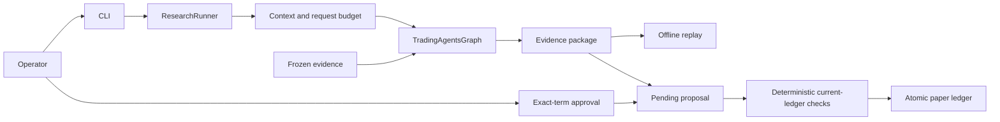

# Architecture blueprint

Decision: leo accepted application composition over TradingAgents v0.4.0. Authoritative design: ADR-001. Scope: one local operator, US equities, English reports, market/news analysts and the complete downstream upstream graph. The application supports research, evidence replay, paper execution and controlled context experiments.

## Drivers and boundaries

The strongest driver is a visible authority boundary between probabilistic research and deterministic portfolio state. Reproducibility requires freezing material data without claiming to recreate stochastic generation. Maintainability requires keeping the upstream graph and tests intact. Cost evaluation requires the same model and graph for both arms, so replacing expensive agents would invalidate this experiment.

The operator invokes a CLI. A ResearchRunner constructs the real graph, supplies context and records callbacks. The EvidenceTradingGraph subclass owns data seams that callbacks alone cannot see, including instrument identity and returns reads. Tool adapters supply fixed corpus data during controlled reruns. Research produces a terminal state and evidence package. It never executes a trade.

## Component ownership

| Element | Owning module | Contract |
|---|---|---|
| Structured records | `models.py` | Explicit persisted fields, normalized statuses and proposal version |
| Settings | `config.py` | Home paths and authoritative teaching policy constants |
| Evidence recording and package IO | `evidence.py` | Capture actual calls, tool data and direct reads; reject incomplete packages |
| Real graph integration | `graph_adapter.py` | Preserve graph roles, freeze non-LLM inputs, derive evidence price |
| Context assembly | `context.py` | Preserve critical facts, remove redundant text only in compact mode |
| Request budget | `budget.py` | Prevent the next model request at the configured limit |
| Approval lifecycle | `review.py` | Exact-term approval, re-review on changed terms, idempotent execution |
| Portfolio policy | `policy.py` | Cash, total-position cap and no-short checks without an LLM |
| Persistent ledger | `storage.py` | SQLite proposal/position/transaction persistence |
| Replay | `replay.py` | Rebuild reports from captured state without creating a model client |
| Presentation | `cli.py`, `report.py` | Commands and inspectable Markdown/HTML outputs |

The new modules reuse upstream public declarations rather than reimplement agent reasoning. Any additional frozen-corpus or evaluation modules remain application owned and do not change vendor routing.

## Authority and execution

Only the local operator can approve exact proposal terms. The model supplies a signal and reasoning. The quantity comes from the operator; the price comes from captured evidence. The deterministic policy uses current ledger state immediately before execution. A content fingerprint is appropriate here because approval must refer to exact terms; it is not a release version. SQLite records a single atomic transaction, and repeated execution returns the original result.

One research run executes sequentially within a process because upstream configuration has process-level state. Independent evaluation processes may run concurrently with separate homes. The ledger supports the single-operator CLI workflow; this release does not expose a concurrent network trading service.

## Verification and observation

Structural checks preserve import/module boundaries and governance records. Regression runs include the complete original upstream suite plus the extension tests. Behavioral verification evaluates exact safety examples and six frozen research cases. Events record context decisions, request counts, provider tokens, tool reads, terminal outcome and stop reason. A successful provider response is evidence of execution, not evidence of factual quality.

Change policy: new requirements update the registry, trace matrix, tests and affected ADR in the same change. Runtime context changes require fixed-set semantic replay and saved live comparison evidence. Failed or budget-stopped runs remain available and cannot become approved research. See the runtime policy catalog for operational actions.
