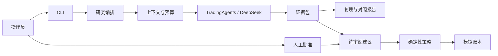

# TradingAgents Research Desk 项目方案

版本：1.0.0。
状态：leo已采纳，OpenCode正在实现。执行来源统一见 `../ai-use-log.yaml`。本文指标为验收目标，实测结果在后续报告中单列。

## 一、交付范围

在现有 TradingAgents 上交付完整流程：**运行研究 → 保存证据包 → 对照研究配置 → 审阅建议 → 确定性策略校验 → 更新模拟账本**。

第一版使用 CLI 和 HTML/Markdown 报告。只支持 market/news 分析员、US 股票和英语研究报告，仍沿用上游 bull/bear、research manager、trader、risk 与 portfolio manager 流程。完成可演示的纵向切片后再考虑界面美化，不接真实交易。

本次评估参与者为leo，evaluation identifier为leo，相对贡献1.0。三项新增功能共同组成可运行流程，不虚构额外成员，也不把机械拆分当作额外个人贡献。

## 二、基线与只读核对结果

建议固定官方 [TradingAgents v0.4.0](https://github.com/TauricResearch/TradingAgents/tree/v0.4.0)，不用滚动 main。已通过 `git ls-remote --tags` 确认标签存在，并下载只读源码到 `/private/tmp/cs5351-tradingagents-v0.4.0`。包版本为0.4.0，要求Python>=3.10。

v0.4.0于2026-08-31发布，包含日期一致性与恢复修复。它是正式标签，但刚发布，不能声称已长期稳定验证；开始实施时跑一次已有离线测试建立本地基线。[官方变更记录](https://github.com/TauricResearch/TradingAgents/blob/v0.4.0/CHANGELOG.md)

已核对的实际接口：

- `TradingAgentsGraph(selected_analysts, debug, config, callbacks)`。
- `propagate(company_name, trade_date, asset_type="stock")` 返回 `(final_state, signal)`，signal可能为REVIEW。
- `save_reports(final_state, ticker, save_path=None)` 输出报告。
- 上游已有结构化输出、decision memory、checkpoint、日期过滤、价格验证、token统计。上述能力都属于继承功能，不能算作本组创新。
- 实际图止于Portfolio Manager，随后保存状态和决策。对源码的查询未找到独立人工批准状态机或模拟账本；README的模拟执行概述不能代替实现证据。

保留上游 `tradingagents/`、`cli/` 和 `tests/`。新增模块放 `src/research_desk/`，新增课程测试放 `test/offline/`、`test/live/`，CI同时跑原测试。不要为符合目录树而重写上游代码。

## 三、新增需求

### F1：研究证据包与离线复现

保存分析日期、股票、模型/配置、prompt版本、实际输入资料、LLM请求/结果/usage、报告、决策及本次用到的记忆。导出资料包并生成来源索引。

离线复现读取已捕获状态与事件，重建报告和模拟策略结果，完全不调用网络。受控重跑则用冻结资料再次调用LLM，供比较配置；LLM的输出仍可能变化，两种功能需要明确区分。

| ID | 优先级 | 需求与fit criterion |
|---|---|---|
| FR-001 | Must | 一条命令导出完整证据包，新进程可导入并重建报告；列出所有实际调用和运行配置 |
| NFR-001 | Must | 固定6包离线复现成功率100%，外部调用数0，结构化决策/策略结果相同；本机单包重建<2秒 |
| SEC-001 | Must | 输出不包含API凭证；所有未来才可用的资料不得用于声明为历史评估的研究 |

报告生成时间等展示元数据不参与一致性判断。文件摘要仅用于完整性，不充当用户版本号。上游已有价格snapshot；增量是跨输入、运行和结果的可移交证据包。

### F2：人工批准的模拟账本

研究结束产生待审阅建议。操作员选择股数并批准，系统根据当前账本、冻结价格与策略判断是否允许模拟执行。状态为 `PENDING_REVIEW → APPROVED/REJECTED → SIMULATED/REVIEW_REQUIRED`。Hold或REVIEW不产生交易。

初版教学策略：现金USD100000、仅整股、禁止卖空、买入后单股票市值<=组合权益10%。批准绑定具体建议版本，执行前重查当前账本；重复执行同一批准不会重复记账。模型只建议方向和解释，不能设定政策、批准者或余额。

| ID | 优先级 | 需求与fit criterion |
|---|---|---|
| FR-002 | Must | 用户可列出建议、看证据、批准/拒绝，观察账本和状态变化 |
| NFR-002 | Must | 固定允许/拒绝/重复执行案例100%符合策略，策略裁决不调用LLM |
| INV-001 | Must | 每项账本变化引用已批准建议版本及通过的确定性策略结果；违规次数0 |
| INV-002 | Must | 未批准、上游REVIEW、资金/持仓不足、超限或价格缺失时不得改变账本；逃逸次数0 |

操作员直接调用review命令，记录实际本机操作者；研究LLM不能调用review或账本工具。第一版是单机个人工作台，不声称实现企业身份认证。安全失败返回明确的REVIEW_REQUIRED或业务拒绝，并保留账本原状态。

### F3：紧凑上下文与成本对照

增加研究调用预算、上下文装配和baseline/compact成对比较。保留股票身份、研究日期、关键价格、站立约束和当前任务；去重重复报告，压缩较旧讨论；压缩后重新加入关键约束。

| ID | 优先级 | 需求与fit criterion |
|---|---|---|
| FR-003 | Must | 同一固定资料集输出两种配置的质量、调用数、input/output tokens、wall time和停止原因 |
| NFR-003 | Must | 达到配置的调用数上限后不开始下一次LLM请求；预算停止结果不可进入可批准建议 |
| QUALITY-001 | Must | 固定6组资料的强制事实字段正确率100%，引用有效率>=95%，支持度与相关性均>=0.8 |
| COST-001 | Should | 同模型/资料/范围下compact总tokens降低>=20%，质量平均下降<=0.05 |
| PERF-001 | Should | compact总wall time不高于baseline的110%，完整报告重试和所有样本 |

复用上游 `max_tokens` 作为每次输出上限，不另造同名配置。总token必须记录真实usage；不声称不同网关下有精确美元硬上限。2组资料用于开发，另4组在开发前冻结；最终完整跑两种配置各6组。引用、评分和应用token分开记录，避免评估费用被隐藏。

MoSCoW取舍：先保证完整工作流和Must项，成本/性能提升有真实比较后才认定达成；图形界面、更多分析员、并行批处理和券商接入不进入第一版。

## 四、最小架构

| 新模块 | 责任 | 复用点 |
|---|---|---|
| `research.py` | 研究生命周期和RunRecord | TradingAgentsGraph、配置、报告 |
| `evidence.py` | 调用/输入记录、资料包、离线复现 | callbacks、现有报告写入器 |
| `context.py` | 选择、去重、压缩、重注入关键约束 | 实际prompt所有者的局部接入 |
| `budget.py` | 调用预算与实际usage | StatsCallbackHandler的计量方式、上游max_tokens |
| `review.py` | 批准状态、策略、账本事务 | 最终signal仅作建议输入 |
| `cli.py` | analyze/export/replay/compare/review命令 | 既有typer/rich |

新字段显式用已有Pydantic声明；新状态用项目SQLite数据库和运行目录。模拟账本与上游研究记忆分开。第一版顺序执行分析，避免上游进程级配置在并发任务中混用。

callbacks不能自动覆盖全部外部数据：identity、回报读取等存在直接数据路径。OpenCode必须先定位这些真实边界，再提出最小接口扩展。禁止全局monkeypatch，禁止在共享vendor路由里按项目名加分支。

候选A：全面改图；候选B：应用层加必要的窄接口；候选C：重写多agent。选择B以控制变更范围，保留上游成熟能力和可比较基线。若真实接入限制阻碍证据完整性，则针对具体接口重开ADR。

记忆设计：记录原始资料、结构化研究结果和模拟账本；每次运行冻结实际使用的上游记忆。先支持同一应用版本恢复，数据schema使用单一语义版本字段；真实格式变化才添加迁移。运行证据保留到课程验收后，删除策略由学生决定；凭证不入库。

## 五、实施切片

1. 固定版本、许可与继承需求，建立已有测试基线。
2. leo采纳 `APPROVAL_PACKET.md` 与 `TEST_PLAN.md`；OpenCode给出精确文件/接口计划后按既定方案实施。
3. 用离线fixture完成证据→建议→review→账本，展示一个批准和一个拒绝案例。
4. 接入一次真实DeepSeek研究，生成完整证据包，记录实际usage。
5. 接入compact与预算，完成固定的成对质量/成本比较。
6. 接通课程六门禁。先完成本地机制，再通过已确认可用的GitHub账户配置私有仓库、required checks与branch protection，展示失败PR及修正结果。
7. 冻结交付，生成报告、ZIP与10分钟演示。会话和干预记录在真实发生时保存，不事后编造。

每个切片围绕正常路径和必要的负面案例验证，不为内部每个函数补镜像测试，不先投入无关重构或前端。

## 六、D1–D9覆盖

| 交付 | 本项目产物与要点 |
|---|---|
| D1 | `docs/req/prd.yaml`、`requirements.yaml`、`req-schema.json`；纳入本文新需求及带来源链接的继承需求 |
| D2 | 根architecture-blueprint；ADR、invariants、trace-matrix、memory-design、permission-model、runtime-policy-catalog、evaluation-table；ADR写上下文层次、装配、预算、压缩和重注入 |
| D3 | AGENTS、结构约束、工具清单、permissions配置、`.agent/rules.md`；human-only规则由leo维护，实现agent不得修改；实际加载和路径权限生效 |
| D4 | 8项关键验收和三层验证；每PR的review memo；实际debt register和bug diary；需求→组件→测试→运行记录可追踪 |
| D5 | 原始OpenCode会话及leo决策，包含先决定测试再实现的真实时间顺序 |
| D6 | 单一Report.md <=10000 words；12pt单倍行距>15页；真实成员姓名/学号、贡献和各300–500词反思 |
| D7 | GitHub源代码、全部旧/新测试、六门禁、required checks、安全路径人review+ADR；账户联网认证已确认，远端步骤待本地成果完成 |
| D8 | 保留上游目录；新src模块和test/offline、test/live；CI跑所有此前测试 |
| D9 | 根Prompt.md先读AGENTS，输出范围/接口/测试/步骤计划，检查leo已有决策记录后按阶段推进；保留实际产品的人工审批机制 |

六门禁：实施前测试批准；每commit静态/依赖检查及安全路径检查；需求schema；prompt/model固定语义评估；全部先前回归；代码/prompt变更更新AI-use log。审批时间和测试版本应从真实记录验证，不能由agent写一个PASS状态代替。

视频10分钟：1分钟原版与问题，2分钟证据/复现，2分钟批准/拒绝，2分钟compact对照，2分钟门禁/追踪，1分钟结果与实际分工。ZIP不包含视频和凭证。

## 七、当前事实与后续依赖

本方案制定时，规划阶段只读核对课程规范和公共源码并生成方案与测试规格。此后已进入OpenCode实现和真实API验证；最终状态与实测结果以项目Report.md、原始会话和evaluation目录为准。

用户已经授权材料发送至api.deepseek.com及API使用，并要求主线程自主决定，不等待再次批准。主线程已采纳本方案。GitHub账户Fighterforever在允许联网的检查下认证正常；先完成本地成果再落实远端交付。参与者统一leo、evaluation identifier leo、相对贡献1.0；来源统一在AI-use/provenance中说明。课程D5份数有one/five/按成员的冲突，完整保存实际会话。

## 当前团队与修订

团队由 Alfa、Bravo、Charlie、Delta 组成，职责和贡献分配见 [team.md](team.md)。原始实现决定与历史事件保留其记录身份。当前非视频修订由 [revision-authorization.md](revision-authorization.md) 授权，具体修订见 ADR-004。
